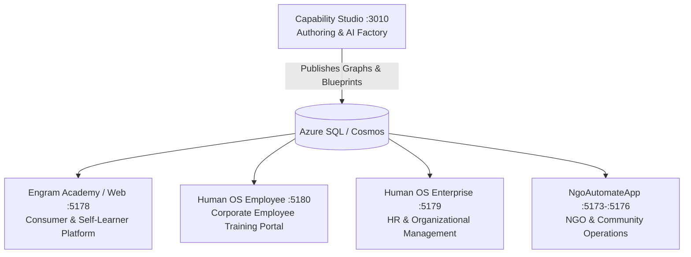
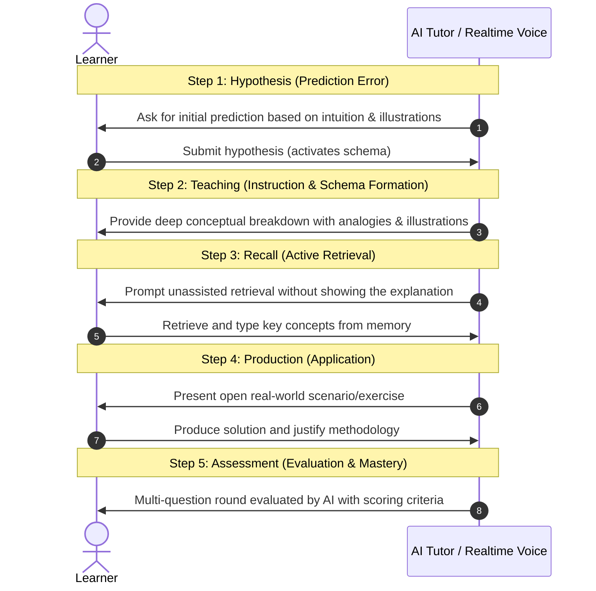
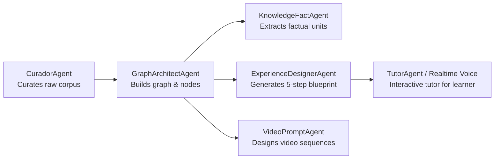

# Engrams & Human OS — Comprehensive System Architecture & Concepts

> **Philosophy**: *Humans First · AI Agents Second.*
> *The ultimate goal of artificial intelligence is not to replace human thinking, but to accelerate human capability, strengthen long-term memory, and turn knowledge into durable mental mastery.*

---

## 1. What is this App Ecosystem?

The **Human OS / Engram Academy** platform is an intelligent educational and workforce development ecosystem composed of interconnected applications:

1. **Engram Academy (`human-os-web`)**: The consumer and learner web application focused on active recall, mastery progression, and graph-guided exploration.
2. **Human OS Employee (`human-os-employee`)**: The employee training portal where workers access assigned career paths (*Mi Puesto*, *Soft Skills*, *Procesos de Depto.*, *Procesos de RRHH*), review their "Brain" mastery index, and track personal evolution.
3. **Human OS Enterprise (`human-os-enterprise`)**: The HR Admin and Manager console for org charts, job descriptions, employee profiles, skill catalogs, and AI-generated career development roadmaps.
4. **Capability Studio (`capabilitystudio`)**: The authoring environment where instructional designers, professors, and HR admins generate courses from raw materials (PDFs, text) via a multi-agent pipeline.
5. **NgoAutomateApp**: Community and non-profit operations platform managing volunteers, members, programs, and daily operations.

---

## 2. What is Capability Studio?

**Capability Studio** is the curriculum generation engine of Human OS. Rather than requiring human educators to manually write hundreds of individual lessons, questions, and summaries, Studio accepts raw source material (such as a 300-page PDF, book, manual, or standard) and orchestrates an autonomous pipeline of AI agents:

1. **Document Intake & Ingestion**: Extracts text, syllabus outlines, and structural hierarchies from PDFs and markdown.
2. **Domain & Topic Scoping**: Categorizes knowledge under Subject Domains (e.g., *Math, Science, Law, Engineering*) and fine-grained Topics.
3. **Graph Architecture**: Decomposes topics into a connected network of **Engrams** (Knowledge Nodes).
4. **Factuals Extraction**: Distills verifiable, grounded **Knowledge Facts** tied to graph paths.
5. **Media & Visual Generation**: Generates contextual illustration prompts, AI image generation, and multi-clip sequential AI educational videos (via Google Veo).
6. **Experience Blueprinting**: Crafts the 5-step cognitive learning contract for each node.

---

## 3. What are Engrams? The Neuroscience of Learning

### 3.1 The Concept of an Engram
In neuroscience, an **engram** is the physical and biochemical trace that a memory leaves in the neural networks of the brain. 

Within this platform:
- An **Engram** is the fundamental atomic unit of learning.
- It is **not** a video to watch passively or a checkbox to mark.
- An Engram is a specific concept or capability that a learner has actively retrieved, practiced, and consolidated into long-term memory.

### 3.2 The Memory Paradox
> *"The easier it is to look up an answer with AI, the weaker your own organic memory becomes if you only search and never recall."*

Traditional educational technology encourages **cognitive offloading** (letting the machine do the thinking). Human OS inverts this dynamic through **Anti-Offloading**:
- The AI acts as a demanding coach/tutor, never as a solver.
- The learner must generate predictions and write answers.
- **Desirable Difficulties**: Productive cognitive friction today produces durable recall tomorrow.

### 3.3 The 5-Step Learning Blueprint per Engram

Every Engram is structured with a deterministic 5-step cognitive progression:

---

## 4. What is the Knowledge Graph?

Rather than presenting courses as flat, linear playlists of slides or chapters, knowledge is modeled as a **Directed Acyclic Graph (DAG)** of interconnected concepts:

- **Graph Nodes (`CapabilityGraphNode`)**: Individual Engrams with academic definitions, practical interpretations, examples, and application cases.
- **Graph Edges (`CapabilityGraphEdge`)**: Pedagogical relationships:
  - `Requires`: Strict dependency (Node B cannot be mastered without Node A).
  - `BuildsOn`: Contextual expansion (Node B extends the schema established in Node A).
- **Cognitive Hierarchy**: Nodal levels progress from fundamental concepts to complex, high-order applications.
- **Global Entity Master Catalog**: Shared canonical concepts (e.g., *Article 1 of VAT Law* or *Ohm's Law*) resolve to the same master node across different documents and courses within the same domain.

---

## 5. Factuals (Knowledge Facts)

**Knowledge Facts (Factuals)** are verifiable units of truth extracted directly from the source text and grounded in the Knowledge Graph:

- **Atomic Facts**: Single-hop relationships between two concepts (e.g., *"ESP32 contains an integrated Wi-Fi and Bluetooth transceiver"*).
- **Composite Facts**: Multi-hop graph paths explaining complex mechanisms (e.g., *"Sensor -> I2C Interface -> Microcontroller -> Flash Memory"*).
- **Fact Classifications**:
  - `Definition`: Canonical meaning of a concept.
  - `Principle`: Foundational rule, constraint, or condition.
  - `Process / Function`: Operational workflow or capability.
  - `Outcome / Application`: Practical result and real-world deployment.
- **Epistemic Status**: Distinguishes facts that are *explicit*, *inferred*, *referenced*, *attributed*, or *hypothetical* (conditional).

Factuals prevent AI hallucinations: when the Tutor Agent conducts a session, it is strictly bounded by the validated Factuals of that Engram.

---

## 6. Multi-Agent Architecture: Agents that Talk to the Graph

Human OS uses specialized agents powered by Microsoft Agent Framework and Azure OpenAI:

1. **CuradorAgent**: Cleans and filters input documents, extracting relevant educational text.
2. **GraphArchitectAgent**: Detects entities, nodes, dependencies (`Requires`/`BuildsOn`), and pedagogical hierarchy.
3. **StructuredLearningKnowledgeFactGenerationAgent**: Extracts grounded Atomic and Composite Knowledge Facts.
4. **ExperienceDesignerAgent**: Creates the 5 blueprint steps (Hypothesis, Teaching, Recall, Production, Assessment).
5. **TutorAgent**: The conversational agent interacting with the student. It is bounded by deterministic state machines (`RuntimeStage`), meaning the LLM cannot skip steps or invent criteria.

---

## 7. Creating Courses from PDFs & Documents

The document conversion workflow in Capability Studio follows an end-to-end pipeline:

1. **PDF Upload & Text Extraction**: Reads text locally via `pdfjs-dist` or on the server via `PdfTextExtractor`.
2. **Syllabus / Index Detection**:
   - *Strict Syllabus Mode*: Respects the exact numbered index of the document (e.g., *Unit 1, 1.1, 1.2*).
   - *Cognitive Complexity Mode*: Lets the AI design the optimal graph depth based on conceptual prerequisites.
3. **Pedagogical Audience Tuning**: Formulates language tone for *Young Learners (K-1/K-2)* or *Standard / Professional* audiences.
4. **Illustration & Media Extraction**: Prompts `gpt-image-1.5` for clear pedagogical diagrams and infographics per node.
5. **Publication**: Saves the graph, blueprints, and assets to Azure SQL and Azure Data Lake Storage.

---

## 8. Real-Time Voice Interaction (Azure OpenAI Realtime API)

To enable true voice tutoring without robotic latency:

- **Technology**: Built on **Azure OpenAI GPT Realtime API** (`gpt-realtime-mini` / `gpt-4o-realtime-preview`) using **WebRTC peer-to-peer audio**.
- **Ephemeral Session Architecture (`RealtimeVoiceSessionService`)**:
  - The backend generates a short-lived ephemeral client token (`POST /openai/v1/realtime/client_secrets`).
  - The backend server injects the strict pedagogical prompt instructions for the current step.
  - The browser establishes a direct WebRTC audio connection to Azure OpenAI, transmitting learner voice and receiving natural synthesized tutor speech in real time with sub-second latency.
  - The master API key is never exposed to the client.

---

## 9. AI Video Generation for Learning (Multi-Clip Sequencing)

Visual explanations are enriched using generative video models:

- **Sequential Continuity**: `StructuredLearningVideoPromptAgent` plans 1 to 4 sequential 10-second video clips (powered by Google Veo).
- **Last-Frame Continuity**:
  - `Mp4LastFrame` extracts the exact final frame of Clip $N$ using ffmpeg (`-sseof -0.5 -frames:v 1`).
  - This frame is automatically injected as the reference starting image for Clip $N+1$.
  - Generates seamless, continuous visual demonstrations of complex physical and conceptual processes.

---

## 10. Summary Matrix

| Concept | Purpose | Technology |
|---|---|---|
| **Engram** | Atomic unit of mastered memory | 5-step cognitive contract (Hypothesis → Assessment) |
| **Knowledge Graph** | Non-linear network of conceptual dependencies | DAG, `CapabilityGraphNode`, `CapabilityGraphEdge` |
| **Factuals** | Grounded truth units for zero hallucination | Atomic & Composite Knowledge Facts with GraphPaths |
| **Studio** | Multi-agent course generation factory | Microsoft Agent Framework, Azure OpenAI |
| **Realtime Voice** | Conversational tutor with low-latency speech | Azure OpenAI Realtime API (WebRTC) |
| **Video Engine** | Multi-clip sequential video generation | Google Veo, last-frame frame-matching, ffmpeg |
| **Enterprise / Portals** | Organizational skills & career roadmap management | React 19, Tailwind CSS v4, i18next (ES/EN) |
