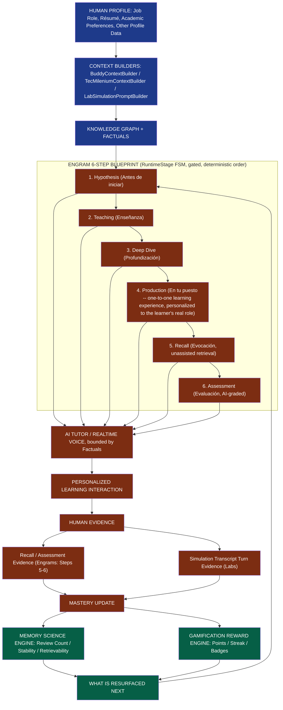
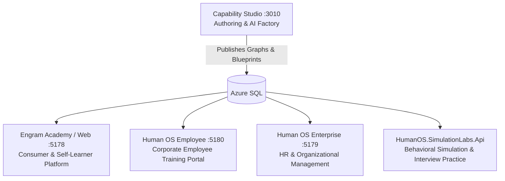
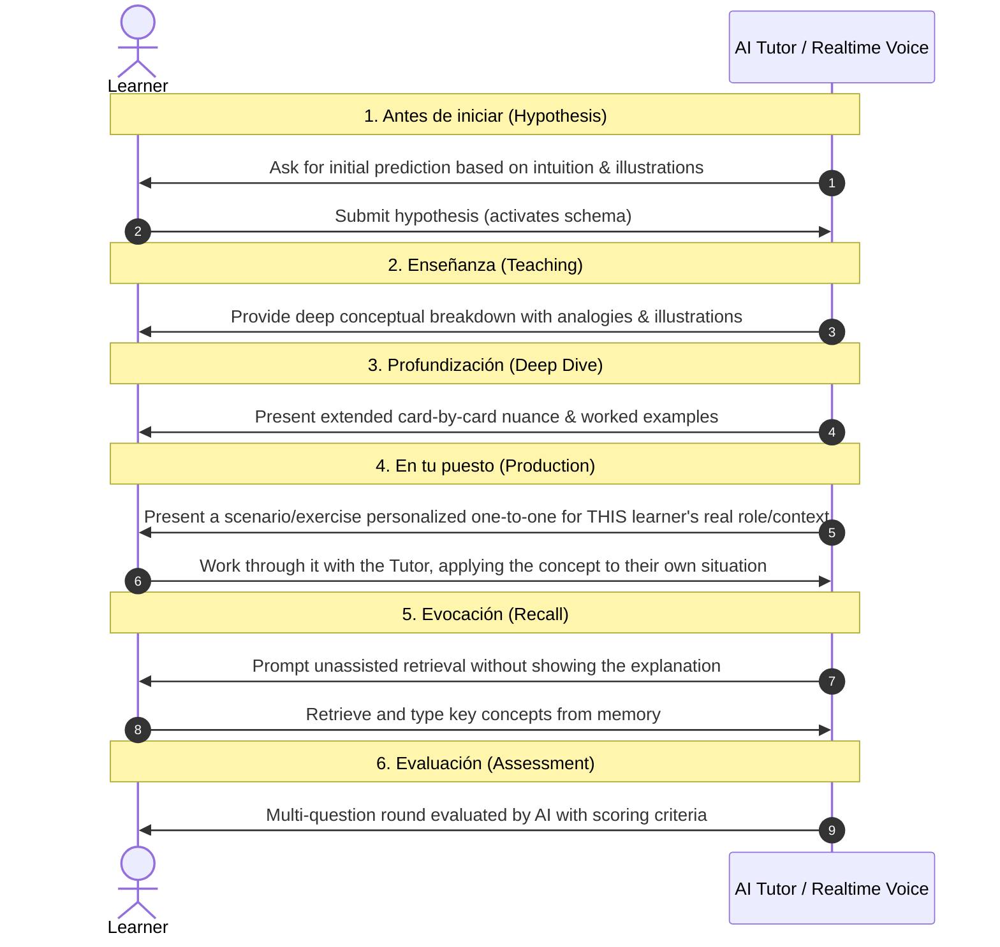
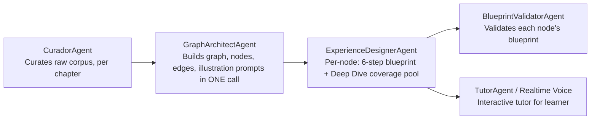
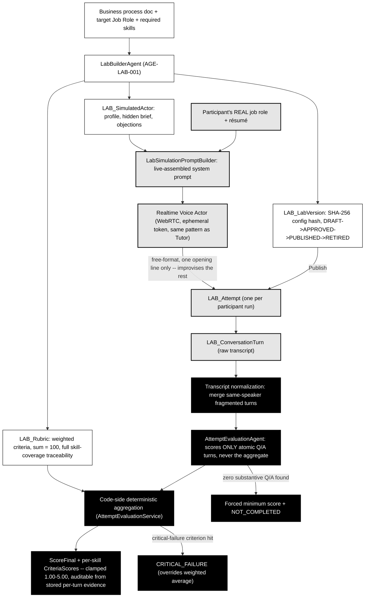
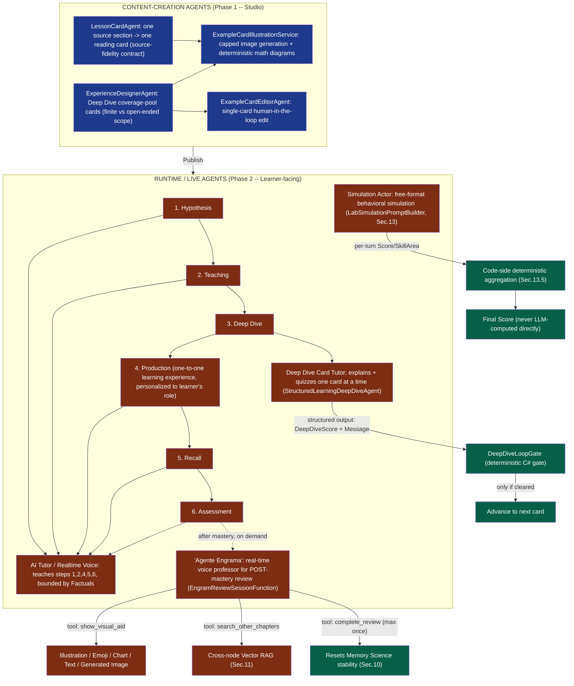
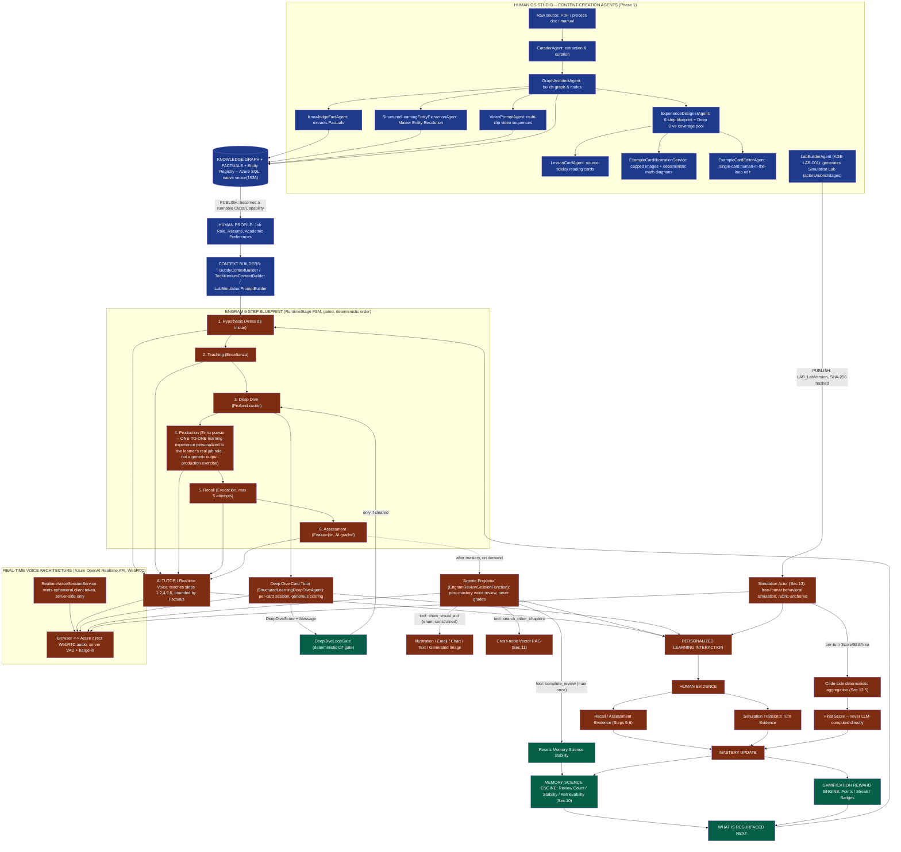
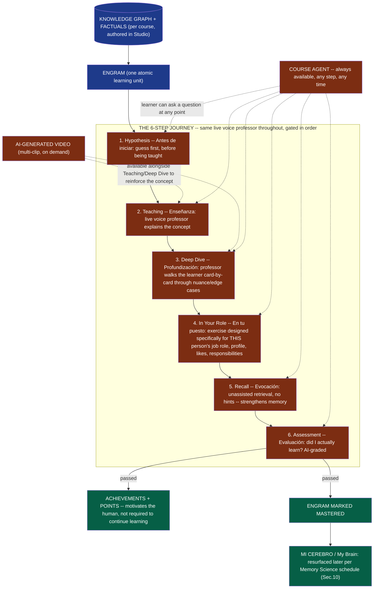

# Engrams & Human OS — Comprehensive System Architecture & Concepts

> **Philosophy**: *Humans First · AI Agents Second.*
> *The ultimate goal of artificial intelligence is not to replace human thinking, but to accelerate human capability, strengthen long-term memory, and turn knowledge into durable mental mastery.*

> **Note on scope (patent-review document)**: This document describes the technical architecture of the **Human OS / Engram Academy learning-and-simulation platform only**. It deliberately excludes unrelated products in the same monorepo that share no algorithmic lineage with what is described here. Every algorithm below is cited against its actual source file, so a reviewing attorney can verify implementation status directly.

---

## 0. The Human OS Personalization Loop (Full Data-to-Behavior Pipeline)

This is the complete, end-to-end closed loop that runs every time a learner interacts with the platform — from their stored human profile, through Studio-authored knowledge, through a live AI-mediated session, to the two independent evidence-and-feedback engines (Memory Science and Gamification) that determine what happens next. This loop is the core technical contribution described in this document; every subsystem below (§1–§13) is a component of it.

*Blue = Human Profile / Studio-authored context and knowledge inputs. Orange = live Runtime Execution (Phase 2), including the 6-step Engram blueprint (§3.3) that is the platform's core differentiator versus flat-video/quiz LMS prior art. Green = the closed-loop personalization outputs (Memory Science + Gamification) that determine the next cycle.*

**Phase 1 — Human OS Studio (content-creation algorithms, §2, §4, §5, §7, §9)**: instructional designers/HR admins feed raw material (a PDF, a business-process document, a standard) into Studio. A multi-agent pipeline (Curador → GraphArchitect → KnowledgeFact → ExperienceDesigner → VideoPrompt agents) autonomously produces, as durable *authored content*: the Knowledge Graph itself (nodes/edges), the Master Entity Registry, the Factuals, the illustration/video "cards," and the voice-tutor prompt templates. Nothing here is learner-facing yet — this is content manufacturing. The AI Lab Builder (§13.2) is the equivalent content-creation algorithm for Simulation Labs (process doc → simulation, not PDF → course).

**Publication boundary**: once authored content passes review, a graph of Engrams is *published* as a runnable **Class / Capability** (or a `LAB_LabVersion` for simulations) — this is the hand-off point between the two phases. Published content is versioned and, for Simulation Labs, cryptographically hashed (§13.1) for integrity.

**Phase 2 — Runtime Execution (§3, §6, §8, §10, Gamification, §13.3–13.5)**: a learner actually *executes* a published Class — each Engram's 6-step blueprint runs live under the `RuntimeStage` finite-state machine, the Tutor/Simulation-actor agent conducts the session bounded by the Factuals/rubric authored in Phase 1, the learner produces Human Evidence (graded answers or scored transcript turns), and that evidence feeds back into the Memory Science engine (§10) and Gamification engine, which together determine what gets resurfaced in the learner's *next* execution — closing the loop without ever re-entering Phase 1.

This two-phase separation — one set of algorithms that *manufactures* a graph-structured, fact-grounded, multi-modal curriculum/simulation, and a distinct set of algorithms that *executes* it against a real human with deterministic state-machine gating and closed-loop memory/reward feedback — is itself a structural claim worth stating explicitly in any patent disclosure, since many prior-art EdTech/LMS systems conflate authoring and delivery into one undifferentiated content-management layer.

---

## 1. What is this App Ecosystem?

The **Human OS / Engram Academy** platform is an intelligent educational and workforce development ecosystem composed of interconnected applications, all reading/writing the same Azure SQL-backed knowledge substrate described in this document:

1. **Engram Academy (`human-os-web`)**: The consumer and learner web application focused on active recall, mastery progression, and graph-guided exploration.
2. **Human OS Employee (`human-os-employee`)**: The employee training portal where workers access assigned career paths (*Mi Puesto*, *Soft Skills*, *Procesos de Depto.*, *Procesos de RRHH*), review their "Brain" mastery index, and track personal evolution.
3. **Human OS Enterprise (`human-os-enterprise`)**: The HR Admin and Manager console for org charts, job descriptions, employee profiles, skill catalogs, and AI-generated career development roadmaps.
4. **Capability Studio (`capabilitystudio`)**: The authoring environment where instructional designers, professors, and HR admins generate courses from raw materials (PDFs, text) via a multi-agent pipeline.
5. **HumanOS.SimulationLabs.Api**: A separate deployable service that generates and runs AI-driven, rubric-graded behavioral simulations (interviews, workplace scenarios) grounded in the same job-role/knowledge data — detailed in §13.

---

## 2. What is Capability Studio?

**Capability Studio** is the curriculum generation engine of Human OS. Rather than requiring human educators to manually write hundreds of individual lessons, questions, and summaries, Studio accepts raw source material (such as a 300-page PDF, book, manual, or standard) and orchestrates an autonomous pipeline of AI agents.

### 2.1 Three distinct content-creation pipelines (verified, not one single sequence)
Studio actually runs **three separate, independently-orchestrated pipelines**, each with its own in-memory run orchestrator — a designer picks one per course, they are never chained together:

| Pipeline | Orchestrator classes | Produces |
|---|---|---|
| **Graph/Blueprint (V2)** | `PdfCapabilityGraphOrchestrator` → `PdfCapabilityGraphPipelineService` | A `CapabilityGraph` of nodes/edges, each node carrying its own 6-step Engram blueprint — this is the pipeline behind most of this document |
| **Traditional/Coursera-style** | `TraditionalCoursePipelineOrchestrator` → `TraditionalCoursePipelineService` | Linear Chapters → Lessons made of reading Cards (`LessonCardAgent`), no Recall/Production steps, ending each chapter in one deterministic multiple-choice exam (`ChapterExamAgent`) |
| **Structured Learning Document** | `StructuredLearningExtractionOrchestrator` (Step 2, deterministic extraction) + `StructuredLearningPedagogyOrchestrator` (Step 3, pedagogy) | Chapter→Section extraction with embeddings, then `StructuredLearningSectionDesignerAgent` designs the Hypothesis→Teaching→DeepDive→Recall→Production→Assessment sequence per section |

### 2.2 Real step order in the Graph/Blueprint pipeline (`PdfCapabilityGraphPipelineService.RunAsync`)
1. **Extract** PDF text plus AI-described embedded images (`PdfContentExtractionService`, `PdfImageDescriptionAgent`).
2. **Detect chapters** (`TocExtractionAgent`, best-effort; falls back to treating the whole document as one chapter).
3–4. **Curate per chapter, then merge** — `CuradorAgent` runs once per chapter (keeps grounding scoped), results merge into one `CuratedCorpus`.
5. **Design the graph** — a single `GraphArchitectAgent` call over the merged corpus (free-form mode), or one call per chapter with cross-chapter isolation (strict syllabus mode) — this one call designs nodes, edges, academic content, and illustration prompts together; it is not split into separate "FactAgent"/"EntityAgent" sub-stages.
6. **Generate + upload illustrations** (`GraphIllustrationImageService`, best-effort).
7. **Persist** the graph (`CapabilityGraphPersistenceService`).
8. **Per node**: optional Bing-grounding lookup for nodes flagged `NeedsCurrentInfo` → `ExperienceDesignerAgent` designs the node's 6-step blueprint → `BlueprintValidatorAgent` validates it → best-effort RAG indexing (`NodeKnowledgeIndexService`) so the Tutor can later answer cross-node questions.

**Correction to earlier drafts**: `KnowledgeFactAgent` (Factuals), `StructuredLearningEntityExtractionAgent` (Master Entity Resolution), and `StructuredLearningVideoPromptAgent` (§9) are **not sequential top-level stages of one unified pipeline** — Facts/Entities are separate services invoked per-section specifically in the **Structured Learning** pipeline, and video-clip generation is a separately-invoked feature, not baked into every pipeline run.

---

## 3. What are Engrams? The Neuroscience of Learning

### 3.1 The Concept of an Engram
In neuroscience, an **engram** is the physical and biochemical trace that a memory leaves in the neural networks of the brain. 

Within this platform:
- An **Engram** is the fundamental atomic unit of learning.
- It is **not** a video to watch passively or a checkbox to mark.
- An Engram is a specific concept or capability that a learner has actively retrieved, practiced, and consolidated into long-term memory.

### 3.2 The Memory Paradox
> *"The easier it is to look up an answer with AI, the weaker your own organic memory becomes if you only search and never recall."*

Traditional educational technology encourages **cognitive offloading** (letting the machine do the thinking). Human OS inverts this dynamic through **Anti-Offloading**:
- The AI acts as a demanding coach/tutor, never as a solver.
- The learner must generate predictions and write answers.
- **Desirable Difficulties**: Productive cognitive friction today produces durable recall tomorrow.

### 3.3 The 6-Step Learning Blueprint per Engram

Every Engram is structured with a deterministic 6-step cognitive progression (`STEP_ORDER` in `StructuredLearningSectionPage.tsx`, enforced server-side by the `RuntimeStage` finite-state machine — the LLM cannot skip steps or invent criteria):

| # | Internal step key | Label (ES) | Label (EN) | Cognitive purpose |
|---|---|---|---|---|
| 1 | `Hypothesis` | Antes de iniciar | Before you start | Prediction-error priming: the learner guesses before being taught, activating prior schema. |
| 2 | `Teaching` | Enseñanza | Learn | Deep conceptual breakdown with analogies & illustrations (schema formation). |
| 3 | `DeepDive` | Profundización | Deep dive | Card-by-card extended exploration of edge cases, nuance, and worked examples (gated step). |
| 4 | `Production` | En tu puesto | In your role | One-to-one personalized learning experience: the scenario/exercise is designed and adapted specifically for THIS learner (their real job role, résumé, context) — not a generic "produce an output" exercise. |
| 5 | `Recall` | Evocación | Recall | Unassisted active retrieval — no explanation shown, learner must reconstruct from memory (gated, max 5 attempts). |
| 6 | `Assessment` | Evaluación | Assessment | Multi-question AI-graded round; must pass to mark the Engram mastered (gated). |

The `RuntimeStage` enum backing the graph-based (non-structured-learning) runtime uses an equivalent state chain: `ModuleStarted → RecallRequired → PredictionRequired → Instruction → LearnerProduction → Assessment → Reflection → Completed` (+ `RequiresRevision` if retries are exhausted).

---

## 4. What is the Knowledge Graph?

Rather than presenting courses as flat, linear playlists of slides or chapters, knowledge is modeled as a **Directed Acyclic Graph (DAG)** of interconnected concepts:

- **Graph Nodes (`CapabilityGraphNode`)**: Individual Engrams with academic definitions, practical interpretations, examples, and application cases.
- **Graph Edges (`CapabilityGraphEdge`)**: Pedagogical relationships:
  - `Requires`: Strict dependency (Node B cannot be mastered without Node A).
  - `BuildsOn`: Contextual expansion (Node B extends the schema established in Node A).
- **Cognitive Hierarchy**: Nodal levels progress from fundamental concepts to complex, high-order applications.
- **Global Entity Master Catalog**: Shared canonical concepts (e.g., *Article 1 of VAT Law* or *Ohm's Law*) resolve to the same master node across different documents and courses within the same domain.

### 4.1 Master Entity Resolution (GraphRAG-style cross-document identity)

Every Engram's source text is run through `StructuredLearningEntityExtractionAgent`, which extracts typed entities (Document, Rule, Action, Value, Entity, and 50 other canonical classes defined in `MasterEntityClasses.cs` — Legal, Geography, Finance, Technology, Science, etc.) and classifies each one against a growing **Master Entity Registry** (`StructuredLearningEntityExtractionService.ResolveEntityAsync`):

- **`matched`**: the entity is confidently the same real-world concept as one already seen in another section/document of the same domain (confidence ≥ 0.90) — merged into the existing master row, aliases combined.
- **`new`**: no reliable candidate exists — a new master entity is created.
- **`ambiguous`**: more than one candidate is plausible (confidence 0.70–0.89) — kept as its own row rather than risking an incorrect merge, so it can be reviewed manually later.
- A safety-net exact-normalized-name match runs even when the LLM's own decision disagrees, so obvious literal duplicates never fragment.

### 4.2 Cross-Course Knowledge Graph ("Grow With Us" / Conocimiento Cruzado)

The `/cross-course-entities` page (`GetPersonCrossCourseEntitiesFunction`) lets a learner freely pick 2+ of their own enrolled courses and synthesizes a **Knowledge Graph and Concepts** view showing which entities repeat across them:

- **Schema summary**: "N engramas dominados · N conexiones formadas" — entity count and occurrence-link count for the selected course set.
- **Per-entity card**: canonical name, entity type (Document/Rule/Action/Value/Entity/…), all verbatim source-text occurrences with the originating Engram/course, and a "Ver en 3D" force-directed graph visualization plus a raw JSON export.
- Entities are ranked by `DistinctCoursesCount` first (concepts that genuinely bridge courses surface above single-course ones), then by total occurrence count.
- This is powered entirely by the same Master Entity Registry from §4.1 — no separate graph database; the DAG is materialized on demand from `StructuredLearningEntitySections` link rows.
- A related, Program-scoped variant (`/program-entities`) restricts the same synthesis to a curated Program instead of a free course selection.

---

## 5. Factuals (Knowledge Facts)

**Knowledge Facts (Factuals)** are verifiable units of truth extracted directly from the source text and grounded in the Knowledge Graph:

- **Atomic Facts**: Single-hop relationships between two concepts (e.g., *"ESP32 contains an integrated Wi-Fi and Bluetooth transceiver"*).
- **Composite Facts**: Multi-hop graph paths explaining complex mechanisms (e.g., *"Sensor -> I2C Interface -> Microcontroller -> Flash Memory"*).
- **Fact Classifications**:
  - `Definition`: Canonical meaning of a concept.
  - `Principle`: Foundational rule, constraint, or condition.
  - `Process / Function`: Operational workflow or capability.
  - `Outcome / Application`: Practical result and real-world deployment.
- **Epistemic Status**: Distinguishes facts that are *explicit*, *inferred*, *referenced*, *attributed*, or *hypothetical* (conditional).

Factuals prevent AI hallucinations: when the Tutor Agent conducts a session, it is strictly bounded by the validated Factuals of that Engram.

---

## 6. Multi-Agent Architecture: Agents that Talk to the Graph

Human OS uses specialized agents powered by Microsoft Agent Framework and Azure OpenAI. As verified in §2.2, `GraphArchitectAgent` performs graph/node/edge/illustration-prompt design in one call — it is not a hand-off to separate Fact/Entity/Video sub-agents as a strictly linear chain:

1. **CuradorAgent**: Cleans and filters input documents, extracting relevant educational text — called once per detected chapter.
2. **GraphArchitectAgent**: Designs nodes, dependencies (`Requires`/`BuildsOn`), academic content, and illustration prompts together in a single structured-output call per corpus.
3. **ExperienceDesignerAgent**: Runs once per graph node to create its 6-step blueprint (Hypothesis, Teaching, Deep Dive, Production, Recall, Assessment).
4. **BlueprintValidatorAgent**: Validates each generated blueprint before persistence.
5. **TutorAgent**: The conversational agent interacting with the student. It is bounded by deterministic state machines (`RuntimeStage`), meaning the LLM cannot skip steps or invent criteria.

Separately, the **Structured Learning Document** pipeline (§2.1) uses its own agent, `StructuredLearningSectionDesignerAgent`, plus dedicated services for Knowledge Facts (`StructuredLearningKnowledgeFactGenerationService`) and Master Entity Resolution (`StructuredLearningEntityExtractionService`, §4.1) — these are pipeline-specific, not universal stages of every course-creation run.

---

## 7. Creating Courses from PDFs & Documents

The document conversion workflow in Capability Studio follows an end-to-end pipeline:

1. **PDF Upload & Text Extraction**: Reads text locally via `pdfjs-dist` or on the server via `PdfTextExtractor`.
2. **Syllabus / Index Detection**:
   - *Strict Syllabus Mode*: Respects the exact numbered index of the document (e.g., *Unit 1, 1.1, 1.2*).
   - *Cognitive Complexity Mode*: Lets the AI design the optimal graph depth based on conceptual prerequisites.
3. **Pedagogical Audience Tuning**: Formulates language tone for *Young Learners (K-1/K-2)* or *Standard / Professional* audiences.
4. **Illustration & Media Extraction**: Prompts `gpt-image-1.5` for clear pedagogical diagrams and infographics per node.
5. **Publication**: Saves the graph, blueprints, and assets to Azure SQL and Azure Data Lake Storage.

---

## 8. Real-Time Voice Interaction (Azure OpenAI Realtime API)

To enable true voice tutoring without robotic latency:

- **Technology**: Built on **Azure OpenAI GPT Realtime API** (`gpt-realtime-mini` / `gpt-4o-realtime-preview`) using **WebRTC peer-to-peer audio**.
- **Ephemeral Session Architecture (`RealtimeVoiceSessionService`)**:
  - The backend generates a short-lived ephemeral client token (`POST /openai/v1/realtime/client_secrets`).
  - The backend server injects the strict pedagogical prompt instructions for the current step.
  - The browser establishes a direct WebRTC audio connection to Azure OpenAI, transmitting learner voice and receiving natural synthesized tutor speech in real time with sub-second latency.
  - The master API key is never exposed to the client.

---

## 9. AI Video Generation for Learning (Multi-Clip Sequencing)

Visual explanations are enriched using generative video models:

- **Sequential Continuity**: `StructuredLearningVideoPromptAgent` plans 1 to 4 sequential 10-second video clips (powered by Google Veo).
- **Last-Frame Continuity**:
  - `Mp4LastFrame` extracts the exact final frame of Clip $N$ using ffmpeg (`-sseof -0.5 -frames:v 1`).
  - This frame is automatically injected as the reference starting image for Clip $N+1$.
  - Generates seamless, continuous visual demonstrations of complex physical and conceptual processes.

---

## 10. The Memory Science Engine ("Mi Cerebro" / Brain page)

This is the algorithm behind the colored freshness circles, the recall %, and the ⚡ Automático badge seen across the Brain/Knowledge-Graph UI. Implemented identically in three places for parity — `frontend/human-os-employee/.../brain/memoryScience.ts`, `frontend/human-os-web/.../brain/memoryScience.ts` (client-side, instant UI updates), and `backend/HumanOS/Services/MemoryScienceEngine.cs` (server-side source of truth) — all three share the exact same constants and formula.

**Model**: power-law forgetting curve (Wixted & Ebbesen, 1991), the same family of formula used by FSRS, the algorithm behind modern Anki:

$$R(t, S) = \left(1 + \frac{t}{9S}\right)^{-1}$$

- $t$ = elapsed days since the Engram was last mastered/reviewed.
- $S$ = **stability** in days — how resistant to forgetting this specific memory currently is.
- $R \in [0, 1]$ = **retrievability** — the real probability the learner can still recall it right now if asked. Shown to the user as a 0–100% badge.

**Stability growth by review count** (`STABILITY_DAYS_BY_REVIEW`): stability increases after every genuine mastery of the same Engram, mirroring how spaced-repetition systems widen the interval after each successful recall — `[8, 8, 18, 40, 80, 150]` days for review 0 through 5 (employee app values; extra reviews beyond index 5 add +30 days each).

**Automaticity threshold**: once `reviewCount >= 5`, the Engram is treated as having crossed from *declarative* memory (explicit, fading, needs review) into *procedural/automatic* memory (Fitts & Posner's "autonomous" skill stage — like riding a bike). Stability is set to `3650` days (~10 years, functionally permanent) and the UI shows the **⚡ Automático** badge instead of a fading percentage.

**Color gradient** (`COLOR_STOPS`): each node's circle is filled (not just a ring) with a traffic-light heat gradient interpolated linearly in RGB space — green (`#16a34a`, R≥~0.9 "Fuerte/Strong") → yellow-green → yellow (`#eab308`, R≈0.5 "Debilitándose/Fading") → orange → red (`#ef4444`, R≈0 "Casi olvidado/Almost forgotten"). Text/icon color on top is chosen automatically from the fill's WCAG relative luminance.

**Next-review date**: `CalculateNextReviewDate` solves $R(t,S)=0.70$ for $t$, i.e. $t = \frac{27}{7}S \approx 3.857S$ days after the last review — the point at which the app proactively flags the Engram for a spaced-repetition nudge (used by the "Practica y refuerza" stale-engram surfacing at the 30-day threshold, and by Mi Cerebro's own review recommendations).

**Global memory score**: `computeGlobalMemoryScore` averages $R$ across every mastered node the learner has — a single 0–100 "how much of everything you've learned do you actually still remember right now" number, computed client-side from data already fetched (no extra backend round-trip).

---

## 11. Vector Embeddings & Semantic Search

Human OS uses native Azure SQL `vector(1536)` columns (`SqlVector<float>`, queried via `EF.Functions.VectorDistance("cosine", ...)`) — no separate vector database — generated by `CapabilityEmbeddingService` (Azure OpenAI `text-embedding-ada-002`, 1536 dimensions). Every consumer below shares this one embedding service:

| Feature | Table / Column | Purpose |
|---|---|---|
| **Node-to-node RAG** (`NodeKnowledgeIndexService`) | `CapabilityGraphNodeKnowledgeChunk.Embedding` | Lets the Tutor answer a question whose fact actually lives in a *sibling* node of the same graph (e.g. a policy number only given as an Example elsewhere), via cosine-distance top-K search. |
| **V1 capability chunks** | `CapabilityKnowledgeChunk.Embedding` | Older Script/Module pipeline's own semantic search index (kept separate from the V2 Graph/Blueprint chunk table above). |
| **Structured Learning entity resolution** (`StructuredLearningKnowledgeRetrievalService`) | `StructuredLearningEntity.Embedding` | Semantic fallback entity matching (only used when exact/alias name matching finds nothing) when answering a learner's free-text question, plus ranking retrieved/related Engrams by real closeness to the query. |
| **Grow With Us saved searches** (`GrowWithUsSavedSearchService`) | `GrowWithUsSavedSearch.Embedding` | Reopening/searching past AI-generated growth plans. Cosine distance alone was found unreliable for short-phrase anisotropy (unrelated names still scored low distance), so a result is only ever admitted if it shares a real keyword (3+ chars) with the query — embeddings are used only to *rank* keyword-matched hits, not to admit them. |

---

## 12. Summary Matrix

| Concept | Purpose | Technology |
|---|---|---|
| **Engram** | Atomic unit of mastered memory | 6-step cognitive contract (Antes de iniciar → Evaluación) |
| **Knowledge Graph** | Non-linear network of conceptual dependencies | DAG, `CapabilityGraphNode`/`CapabilityGraphEdge`, Master Entity Registry, Cross-Course synthesis |
| **Factuals** | Grounded truth units for zero hallucination | Atomic & Composite Knowledge Facts with GraphPaths |
| **Studio** | Multi-agent course generation factory | Microsoft Agent Framework, Azure OpenAI |
| **Realtime Voice** | Conversational tutor with low-latency speech | Azure OpenAI Realtime API (WebRTC) |
| **Video Engine** | Multi-clip sequential video generation | Google Veo, last-frame frame-matching, ffmpeg |
| **Memory Science** | Forgetting-curve retrievability & freshness UI | Wixted & Ebbesen power-law (FSRS-style), `MemoryScienceEngine.cs` |
| **Semantic Search** | Cross-node/course RAG & saved-search recall | Azure SQL native `vector(1536)`, cosine `VectorDistance` |
| **Gamification / "Brain"** | Points, streaks, badges on Engram mastery | `GamificationOrchestrator` → `RewardEngineService`/`StreakService`/`BadgeService` |
| **Simulation Labs** | AI-generated, rubric-graded behavioral simulations | `HumanOS.SimulationLabs.Api` — see §13 |
| **Enterprise / Portals** | Organizational skills & career roadmap management | React 19, Tailwind CSS v4, i18next (ES/EN) |

---

## 13. Simulation Labs — AI-Generated, Rubric-Graded Behavioral Simulation

A separate deployable service (`HumanOS.SimulationLabs.Api`) that generates and runs realistic, high-stakes conversational simulations (job interviews, client negotiations, academic thesis defenses, workplace conflict scenarios) to practice and objectively score *human behavior*, not just declarative knowledge. All claims below are verified directly against source, with file/class names cited, for legal review.

### 13.1 Immutable versioned domain model
`LAB_Lab` → `LAB_LabVersion` (status machine `DRAFT → APPROVED → PUBLISHED → RETIRED`; a published version is never mutated in place — any edit requires a brand-new version) → `LAB_Scenario` → one or more `LAB_SimulatedActor` → `LAB_Stage`/`LAB_ExpectedMoment`/`LAB_Rubric`/`LAB_RubricCriterion` → `LAB_Attempt` (one per participant run) → `LAB_ConversationTurn` (raw transcript) → `LAB_AttemptEvaluation` (final graded result). Each `LabVersion` carries a **reproducible SHA-256 configuration hash** (`LabVersionService.ComputeConfigurationHash`) over its own canonical field serialization — a tamper-evident fingerprint of exactly what was practiced/graded, usable as an audit/integrity primitive.

### 13.2 AI Lab Builder — generative simulation authoring (`LabBuilderAgent`, "AGE-LAB-001")
Given a real business process document, a target job role, and a list of required skills, this agent generates a **complete, reusable simulation** in one pass: realistic simulated actor(s) (never the trainee's own role), a stage/objective breakdown, and — critically — a weighted rubric whose **criterion weights are constrained to sum to exactly 100**, with an explicit guarantee that **every requested skill maps to at least one rubric criterion** (full skill-coverage traceability from input skill list to generated grading criteria). The agent also enforces a **fidelity constraint**: every generated stage must be traceable back to the source process text, preventing invented steps that contradict the real business process.

### 13.3 Free-format conversational simulation (not decision-tree branching)
An earlier scripted-dialogue-tree design was deliberately replaced: the generated Lab contains only **one authored opening line** (the actor's conversational opener), after which the AI actor improvises the entire remaining conversation live, grounded only in its structured `LAB_SimulatedActor` profile (objective, hidden brief, information it may/may not reveal, objections, contradictions, communication style) and the rubric it will ultimately be judged against. This is a deliberate move away from brittle branching logic toward open-ended, rubric-anchored improvisation — the rubric constrains evaluation validity without constraining conversational freedom.

### 13.4 Real-time voice grounding in the trainee's actual professional identity
Voice sessions use the same ephemeral Azure OpenAI Realtime/WebRTC token-minting pattern as the Tutor (§8), but the system prompt is live-assembled per attempt (`LabSimulationPromptBuilder.BuildInstructions`) from the **real participant's own job role and résumé data** (fetched from the main HumanOS backend) — so a simulated interviewer/client actually references the real candidate's real skills/résumé instead of a generic persona. A same-language-authored instruction-priming technique is used to prevent accent bleed-through (the language rule is written, and appears first, in the actor's own target-spoken language, rather than in English-authored meta-instructions) — an empirically-derived fix for an observed failure mode where actors drifted into an English accent regardless of spoken-language setting.

### 13.5 Deterministic, hallucination-resistant scoring algorithm (`AttemptEvaluationService` + `AttemptEvaluationAgent`)
This is the most patent-relevant mechanism in Simulation Labs:
1. **Transcript normalization**: consecutive same-speaker turns (caused by natural mid-answer pauses or speech-to-text chunking) are merged into single coherent turns before grading, so the evaluator never sees an artificially fragmented answer.
2. **The LLM scores only atomic turns, never the aggregate**: the agent emits one `Score` plus `SkillArea` (TECHNICAL/SOFT) per actual question/answer exchange found in the transcript — it never outputs the final grade directly.
3. **Deterministic aggregation in code, not the LLM**: `ScoreFinal` and per-skill-area `CriteriaScores` are computed as code-level averages over the LLM's own per-turn evaluations. A topic never actually raised in conversation can therefore never silently influence the score, and the final score is always mathematically reconstructable/auditable from the stored per-turn evidence — a concrete architectural safeguard against LLM grading hallucination.
4. **Hard numeric safety net**: if zero substantive question/answer pairs are found, the system forces a safe minimum score and a `NOT_COMPLETED` result rather than trusting an out-of-range or fabricated LLM value; all scores are clamped to the database-enforced 1.00–5.00 range regardless of what the model returns.
5. Grading is always performed against the same weighted, skill-traceable rubric generated in §13.2 — critical-failure criteria can force a `CRITICAL_FAILURE` result independent of the weighted average.

### 13.6 Verified NOT-yet-active feature (flagged for accuracy)
A multi-actor "committee" round-robin mode (for panel-style simulations, e.g. thesis defense committees) exists fully coded in `AttemptVoiceSessionFunction` but is gated behind a hard-coded `if (false && ...)` — explicitly disabled per a 2026-09-17 product decision because the round-robin handoff did not sound reliable in practice. Any patent claim involving multi-actor simulation should describe this as implemented-but-disabled, not shipped.

### 13.7 Simulation Labs — Full Pipeline Diagram (Authoring to Auditable Score)

**What this diagram shows, box by box, for patent review:**

- **`Doc` → `LabBuilderAgent`** (blue, Phase 1/authoring): the inventive input is not a generic prompt but a *real business process document* plus a target Job Role and an explicit list of required skills — the generative step is grounded in the employer's own process, not invented from general LLM knowledge.
- **`LAB_SimulatedActor` / `LAB_Rubric` / `LAB_LabVersion`** (blue, outputs of the builder, all durable and versioned): the rubric is the key inventive artifact — weights are constrained to sum to exactly 100 and every input skill is guaranteed to map to at least one grading criterion, so the grading instrument is provably complete relative to what was requested, not an arbitrary LLM-invented checklist. `LabVersion`'s SHA-256 hash makes every published simulation a tamper-evident, reproducible artifact — useful both as a technical safeguard and as evidentiary support that a specific claimed configuration was what a specific trainee actually practiced against.
- **`Resume` + `Actor` → `Prompt` → `Voice`** (orange, runtime): the simulated actor is not a static persona — its live system prompt is assembled per attempt from the real trainee's own job role/résumé, so the simulated interviewer/client references the real person's real background. The actor improvises the entire conversation after one single authored opening line — this is the deliberate move away from brittle decision trees, which matters for the claim because it's what makes the simulation behave like open-ended human conversation instead of a scripted quiz with a chat skin.
- **`Transcript` → `Normalize` → `PerTurn`** (green, deterministic/code + constrained-LLM): this is the anti-hallucination scoring chain and the strongest part of the claim. The LLM is never asked to produce a final grade — it only scores one already-merged, atomic question/answer exchange at a time.
- **`Agg` → `Final` / `CritFail` / `SafetyNet`** (green, fully code-enforced): the final numeric score is a deterministic average computed in C# over the LLM's own stored per-turn scores — never a single LLM-generated number — making every score mathematically reconstructable and auditable after the fact. Two hard safety nets are explicit code paths, not model behavior: a critical-failure rubric criterion can override the weighted average entirely, and a transcript with zero substantive exchanges is forced to a safe minimum score rather than trusting whatever number the model might otherwise emit.

**Why this whole diagram matters as one claim**: taken together, it demonstrates a generate→ground→converse→score pipeline where the *only* two places an LLM is allowed to act freely (rubric/actor authoring, and per-turn atomic scoring) are each independently bounded by a deterministic, code-enforced constraint immediately downstream (skill-coverage completeness; code-side aggregation) — the same "LLM proposes, code decides" discipline already asserted in §14.4, now shown end-to-end for one complete subsystem.

---

## 14. Full Backend Agent Catalog (UX + Algorithm Detail)

This section documents every distinct real-time and authoring AI agent in the platform, with the concrete UX surface it drives and the deterministic logic wrapped around it — the level of detail a patent examiner needs to see that the LLM is always constrained by code, never freely improvising the parts that matter (grading, content fidelity, tool gating).

*Blue = content-creation agents (Phase 1). Orange = live/runtime agents, the 6 Engram steps they teach, and their gated tool calls (Phase 2). Green = the deterministic, code-enforced outcomes that every agent's output ultimately funnels into — never a raw, untrusted LLM write to a learner's permanent record.*

### 14.1 "Agente Engrama" — the real-time voice professor that answers questions during review
**Backend**: `EngramReviewSessionFunction.cs` (mints the Realtime session) — grounded ENTIRELY in the student's own most recently completed attempt at a node, reusing `InstructorRuntimeOrchestrator.GetNodeSummaryAsync` (the same read model as the recap screen) so the agent can reference the student's own past written answers verbatim, not just the static lesson text.
**UX**: `EngramReviewAgent.tsx` — a full-screen (or embedded, e.g. inside a Deep Dive card modal) voice-call presence, launched from the "Reactivar Engrama" button on a node's recap screen, or focused on one specific Deep Dive card via `exampleCardIndex`.
**Key algorithmic properties**:
- **Never grades** — explicitly a study companion, not an exam; hard-coded in the system prompt (`hardBoundaries`) and structurally enforced by never writing to `LearningEvidence`/`LearningSession` tables (a parallel, read-only voice channel).
- **Three Realtime function-calling tools, each independently gated**:
  1. `show_visual_aid` (5 kinds: `illustration` id-lookup from a pre-built catalog, `emoji`, `chart`, `text`/"whiteboard", `generated_image` on-demand via `gpt-image-1.5`) — the model picks a kind via a constrained JSON schema enum, never free text, so the frontend always knows exactly how to render the result.
  2. `search_other_chapters` — cross-node RAG lookup (reuses `NodeKnowledgeIndexService`'s vector search, §11) so the agent can answer a question about a *different* chapter of the same course on demand, instead of the whole course being stuffed into every session's prompt upfront. The agent is told the *names* of sibling chapters (cheap) but never their content (fetched only on demand) — a deliberate two-tier context-loading pattern.
  3. `complete_review` — a one-shot completion signal the model may call **at most once**, and only after judging the *entire* lesson was genuinely reviewed with real active recall (not a short/partial session). Firing it triggers `EngramReviewCompletion` persistence, which resets the Memory Science forgetting-curve stability (§10) back to full strength — i.e., a voice-only review session can legitimately refresh a learner's memory state, same as a graded practice attempt, without ever going through the graded Assessment step.
- **Idempotency safeguard**: the Realtime API can report the same completed tool call twice (`response.output_item.done` then again inside `response.done`); the frontend deduplicates by `call_id` to prevent the agent from answering its own tool call twice and spiraling into runaway responses.
- **True voice barge-in**: mic stays live at full gain even while the agent speaks (not gain-ducked), so Azure's own server-side VAD can detect real interruption and auto-truncate the agent's response — a documented fix for an earlier failed gain-ducking approach that suppressed the student's voice below the VAD threshold.

### 14.2 Deep Dive Card Tutor — the agent that explains cards one at a time
**Backend**: `StructuredLearningDeepDiveAgent.cs` — a persistent, per-card `AgentSession` (one conversation thread per card, keyed `"{sectionStepId}:{cardIndex}"`) so the whole back-and-forth on one card (initial explanation → student questions → wrap-up) is one coherent multi-turn context, not a series of stateless calls.
**UX**: the Deep Dive step's card-by-card modal browser (gated, sequential — the learner cannot skip ahead to card N+1 until card N is cleared, enforced by `DeepDiveLoopGate`, a deterministic C# gate, not an LLM decision).
**Algorithm**: every turn returns two things in one structured response — (1) a 0–100 `DeepDiveScore` (deliberately generous: any non-confused acknowledgment scores ≥80, since Deep Dive is explicitly a *walkthrough*, not a quiz) and (2) a `Message` that is either the card's first-turn explanation, an answer to a genuine follow-up question, or a wrap-up close. The explicit generosity bias is a deliberate product/pedagogical decision baked into the prompt, not a training artifact — worth citing as intentional system design.

### 14.3 Card-Creation Agents (Content-Creation Phase, §0/Phase 1)
Several distinct agents generate the illustrated "cards" a learner later sees — each with a narrow, auditable responsibility:
- **`LessonCardAgent`** (Traditional/Coursera-style course pipeline): converts exactly one curated source section into exactly one reading card, in "professor voice," under a hard **source-fidelity contract** — it must preserve the source's own wording/tone/examples/numbers rather than paraphrase generically, and its illustration prompt is defensively checked by `NormalizeIllustrationPrompt` (a plain C# keyword-matching guard, not an LLM call) to catch and correct "logo drift" (the model wandering into generating an abstract brand logo instead of the actual taught content).
- **`ExperienceDesignerAgent`** (Graph/Blueprint pipeline): generates the optional Deep Dive step's full "coverage pool" of example cards — the prompt explicitly instructs the model to reason about whether a concept's scope is *finite/enumerable* (generate one card per item, e.g. all 26 letters) or *open-ended* (generate 15–30 representative cards), rather than an arbitrary fixed count — a concrete scope-completeness algorithm, not just "make some examples."
- **`ExampleCardIllustrationService`**: generates a real image for only a capped subset of cards (`MaxIllustratedCardsPerNode = 10`, a hard cost safety net independent of what the LLM suggests), preferring the agent's own content-accurate `DiagramPrompt`/`MathDiagram` over a generic synthesized prompt; math/statistics diagrams (circles, parabolas, bar/pie charts) are rendered **deterministically via SkiaSharp**, never by the generative image model — because a generative model cannot reliably place a labeled point/bar at an exact numeric coordinate.
- **`ExampleCardEditorAgent`**: a scoped, single-card human-in-the-loop editor — a Studio reviewer can free-text-instruct a change to exactly one card, guaranteed by the surrounding service (not the LLM) to leave every other card in the pool untouched, fixing an earlier incident where a whole-step editor silently discarded 20 cards because it had no concept of per-card structure.

### 14.4 Summary: what is LLM-authored vs. code-enforced
| Decision | Who decides | Mechanism |
|---|---|---|
| Whether a tool call is even offered | Code | `knowledgeSearchAvailable`, illustration catalog non-empty, etc. — computed server-side before the prompt is built |
| Which visual-aid *kind* to use | LLM, constrained | JSON schema `enum` — model cannot emit free-form kinds |
| Whether a review "counts" as complete | LLM proposes, code persists | `complete_review` tool call → `EngramReviewCompletion` row write |
| Final Engram/Simulation score | Code | Deterministic aggregation over per-turn LLM scores (§13.5) |
| How many cards get a real illustration | Code | Hard cap (`MaxIllustratedCardsPerNode`), independent of LLM's own suggestions |
| Whether a math diagram is AI-generated or rendered exactly | Code | `MathDiagram` (SkiaSharp, exact) vs. `DiagramPrompt` (generative) — mutually exclusive, model picks which category applies, code renders accordingly |
| Card-pool scope completeness (finite vs. open-ended) | LLM, per explicit reasoning rule in prompt | `ExperienceDesignerAgent`'s "COVERAGE POOL" instructions |

This LLM-proposes/code-decides discipline, repeated consistently across every agent in the platform (Engrams, Simulation Labs, and content-creation alike), is itself a structural pattern worth asserting as a unified inventive concept: **no single agent call is ever trusted, unverified, to directly mutate a learner's permanent record or a grade** — every consequential state change passes through a deterministic C# gate that consumes the LLM's structured output as a proposal, not a command.

---

## 15. Master Architecture Diagram (Full System, 100% — Studio, Agents, Voice, 6 Steps, Personalization)

One consolidated diagram covering every verified component described in this document: Human OS Studio's content-creation agents, the published Knowledge Graph/Factuals substrate, the Engram's 6-step blueprint, every runtime agent (Tutor, "Agente Engrama", Deep Dive Card Tutor, Simulation Actor), the real-time voice architecture (ephemeral token + WebRTC), every gated tool call, and the closed-loop Memory Science + Gamification feedback that personalizes the next cycle.

*Blue = Phase 1, Human OS Studio content-creation agents and the published Knowledge Graph they produce. Orange = Phase 2, every live runtime agent, the 6-step Engram blueprint, the shared real-time voice architecture, and the evidence they generate. Green = deterministic, code-enforced outcomes (gates, score aggregation, Memory Science, Gamification) that close the loop back to Step 1. Note: the platform's cognitive contract is verified as exactly 6 steps (`STEP_ORDER` in `StructuredLearningSectionPage.tsx`) — not 7 — Hypothesis, Teaching, Deep Dive, Production, Recall, Assessment.*

---

## 16. Engram Lifecycle Loop (Simplified Single-Claim Diagram)

A single linear lifecycle diagram — the simplest possible representation of the platform's core inventive loop, annotated with the exact mechanism backing every step, each traceable to the detailed sections above. This is the diagram to lead a patent claim with; §0/§15 are the detailed technical appendices that prove each box out.

```mermaid
graph TD
    ENGRAM["ENGRAM<br/>Atomic unit of mastered memory (Sec.3) -- a graph node with academic definition, examples, Factuals"]
    ENGRAM --> HYP

    HYP["HYPOTHESIS<br/>Learner predicts before being taught (prediction-error priming), activates prior schema"]
    HYP --> TEACH

    TEACH["TEACH<br/>AI Tutor / Realtime Voice explains, bounded by Factuals (Sec.5, Sec.8) -- zero hallucination"]
    TEACH --> DEEPDIVE

    DEEPDIVE["DEEP DIVE<br/>Card-by-card coverage pool (finite-vs-open-ended scope algorithm, Sec.14.3), gated: must clear card N before N+1 (DeepDiveLoopGate)"]
    DEEPDIVE --> PRODUCTION

    PRODUCTION["PRODUCTION (En tu puesto)<br/>ONE-TO-ONE learning experience: the scenario is designed/personalized specifically for THIS learner's real job role/context (Sec.0 Context Builders) -- not a generic 'produce an output' exercise"]
    PRODUCTION --> RECALL1

    RECALL1["RECALL<br/>Unassisted active retrieval, no explanation shown, gated (max 5 attempts) -- generates Recall Evidence"]
    RECALL1 --> ASSESS

    ASSESS["ASSESSMENT<br/>Multi-question AI-graded round; LLM scores atomic turns only, code aggregates deterministically (Sec.13.5 pattern) -- must pass to advance"]
    ASSESS --> MASTERY

    MASTERY["MASTERY<br/>GamificationOrchestrator fires: RewardEngineService (points/difficulty/surprise multipliers) + StreakService + BadgeService (Sec.12)"]
    MASTERY --> MEMSCI

    MEMSCI["MEMORY SCIENCE<br/>Stability (S, days) set/increased by review count; Retrievability R(t,S) = (1 + t/9S)^-1 (Wixted & Ebbesen power-law, Sec.10)"]
    MEMSCI --> WEAKENS

    WEAKENS["MEMORY WEAKENS<br/>R decays as elapsed days t grows; UI freshness circle fades green -> yellow -> red (Sec.10 color gradient)"]
    WEAKENS -->|"R crosses ~70% threshold, t = 3.857*S (CalculateNextReviewDate)"| RESURFACE

    RESURFACE["ENGRAM RESURFACED<br/>Proactively flagged for spaced review ('Practica y refuerza', 30-day threshold; or on-demand via 'Agente Engrama' voice review, Sec.14.1)"]
    RESURFACE --> RECALL2

    RECALL2["RECALL (repeat)<br/>Same unassisted-retrieval mechanism as above, OR live voice active-recall walkthrough (EngramReviewSessionFunction)"]
    RECALL2 --> STRENGTHEN

    STRENGTHEN["MEMORY STRENGTHENED<br/>Review count increments -> Stability grows (widening interval, Sec.10); at reviewCount>=5, crosses into procedural/automatic memory (~3650-day stability, Automatico badge)"]
    STRENGTHEN -.->|"loop continues indefinitely"| MEMSCI

    style ENGRAM fill:#1e3a8a,color:#fff
    style HYP fill:#7c2d12,color:#fff
    style TEACH fill:#7c2d12,color:#fff
    style DEEPDIVE fill:#7c2d12,color:#fff
    style PRODUCTION fill:#7c2d12,color:#fff
    style RECALL1 fill:#7c2d12,color:#fff
    style ASSESS fill:#7c2d12,color:#fff
    style MASTERY fill:#065f46,color:#fff
    style MEMSCI fill:#065f46,color:#fff
    style WEAKENS fill:#065f46,color:#fff
    style RESURFACE fill:#065f46,color:#fff
    style RECALL2 fill:#7c2d12,color:#fff
    style STRENGTHEN fill:#065f46,color:#fff
```

*Blue = the Engram unit itself (product of Phase 1/Studio). Orange = the learner-facing execution steps of the 6-step blueprint, repeated identically on every resurfacing cycle. Green = the deterministic, code-computed feedback mechanisms (Gamification, Memory Science formula, resurfacing scheduler) that make this loop self-sustaining and personalized without ever re-invoking a human author. Every label is annotated with its exact backing algorithm/service name and source section for legal traceability — this diagram is the complete lifecycle claim; nothing in the platform's core loop is omitted.*

---

## 17. "Recomienda contenido relevante" — Content Recommendation Agent (2026-09-29)

A standalone, on-demand advisory agent — sidebar-abbreviated as **"Recomendaciones"** in `human-os-employee` (route `/recomendaciones`, Sparkles icon) — that recommends content based on a student's declared tastes/interests, academic performance, and the *live* current state of their field, and lets the student keep a running, revisitable history of past recommendations.

- **Agent**: `Agents/ContentRecommendationAgent.cs` — a `ChatClientAgent` (structured output `ContentRecommendationProposal`: `Title`, `Summary`, `RecommendedItems[]` (Title/Type/Reason/Url), `TrendsSummary`), same `.AsAIAgent(instructions:, name:)` construction pattern as `GrowWithUsPlanAgent` (§0's Context Builders family).
- **Skill 1 — live web search**: before invoking the agent, `GenerateContentRecommendationsFunction` calls the existing `PerplexitySearchService` (Sonar model, already used elsewhere for Tec Contigo/Studio grounding) with a query built from the student's declared `AcademicInterests`, so recommendations and the `TrendsSummary` are grounded in real, current sources rather than invented ones — the agent is instructed to never fabricate a URL, mirroring the zero-hallucination discipline described for Factuals in §5.
- **Skill 2 — send email**: `TecMileniumNotificationEmailService.SendContentRecommendationsAsync` (SendGrid) emails the student a saveable plain-text + HTML copy of the report to their own address — opt-in per generation (`sendEmail` flag) or on demand later via `SendContentRecommendationEmailFunction` for any previously saved report.
- **Context**: gathered from existing profile data only — `PersonResumeService` (professional objective, `StudentAcademicProfile.Degree`/`CumulativeAverage`), `PersonAcademicPreferencesService` (`AcademicInterests`/`LearningPreferences`), and `CapabilityEnrollmentService` (completed courses, so the agent never re-recommends something already finished) — the same profile substrate feeding `BuddyContextBuilder`/`TecMileniumContextBuilder` in §0.
- **Saved-searches history**: every generation is persisted as a new row in `ContentRecommendationSavedSearch` (PersonId, Topic, `ResultJson`, CreatedDate — history, not a single "latest" row) via `ContentRecommendationService`, shown in a left-side panel the student can reopen anytime; new questions are appended to the on-screen result list rather than replacing the previous answer, so a session's full Q&A history stays visible.
- **Endpoints**: `POST /people/{personId}/content-recommendations` (generate + save + optional email), `GET .../content-recommendations` (list), `GET .../content-recommendations/{id}` (reopen), `POST .../{id}/send-email` (re-send a saved report).

---

## 18. Buddy — Real-Time Voice Companion Grounded in Organizational Context (2026-09-22/28)

**Buddy** ("Tu compañero en el trabajo") is a low-latency, spoken-voice agent on the employee home page (`GrowWithUsPlanAgent`'s sibling for conversation rather than plan generation), distinct from the course-specific tutoring agents documented in §14. Its defining trait is that it is grounded, in a single turn, in **three categories of context that normally live in separate systems**:

1. **Personal/academic context**: the employee's profile, skills, CQI score, objectives, and an achievements/completed-classes summary (`EmployeeScoringProfileService`, `PersonCqiProfileService`, `CapabilityEnrollmentService`).
2. **Live organizational-chart context**: the employee's own job role, department, and — critically — their direct manager's name/title, resolved from the real `Person`/`JobRole`/`Department` hierarchy, not a static FAQ. This lets Buddy answer "who is my manager" or "what does my department do" truthfully and per-tenant.
3. **Live external/web context**: a single Realtime tool, `search_the_web` (`BuddyWebSearchFunction` → `PerplexitySearchService`, the same grounding service reused by §17's Recomendaciones agent), which the model calls instead of ever inventing an industry fact, definition, or best practice.

**Architecture**:
- `BuddyContextBuilder.BuildInstructionsAsync` assembles all of #1 and #2, server-side only, into one Realtime `instructions` string (the browser never sees or can influence this text — same read-only guardrail pattern as `LearnerContextBuilder`/§7's Realtime tutor). It never throws: an employee with a sparse profile still gets a fully usable, generically-grounded Buddy.
- `BuddyVoiceSessionFunction` (`POST humanos/buddy/voice-session`) authenticates the caller via `X-Azure-OID`/`X-Azure-TID` headers, resolves the real `PersonId` server-side (the client cannot spoof whose context it receives), and mints a short-lived Azure OpenAI Realtime session pre-loaded with the instructions and the one `search_the_web` tool definition.
- `BuddyWebSearchFunction` (`POST humanos/buddy/web-search`) is the tool's actual execution endpoint: the browser relays the model's `search_the_web` function-call arguments here (it cannot reach the Perplexity API key directly), the server calls `PerplexitySearchService`, and the answer is fed back to the live voice session as a `function_call_output` over the Realtime data channel — the same call/response tool-bridge pattern used by `EngramReviewAgent`'s `search_other_chapters` tool in §7.
- `TecContigoAgent`/`TecContigoVoiceSessionFunction` (§4) follow the identical Realtime-session + single-tool pattern but are scoped to a program's cross-course knowledge graph rather than the employee's organizational identity — the two agents are explicitly kept separate so Buddy never drifts into course content and Tec Contigo never drifts into HR/org data.

**Why this is distinct from a scripted chatbot/FAQ**: Buddy's response on any given turn is assembled from data resolved at request time from three independently-changing sources (live org chart, live personal learning record, live web), through one authenticated, tenant-scoped, server-built prompt — not a fixed knowledge base or static intents list.

---

## 19. The Employee's Full Course Experience (One Engram, Start to Finish)

One consolidated diagram of what a single employee actually lives through, end to end, when they take one Engram within a course — combining the Knowledge Graph/Factuals substrate, the 6-step blueprint, the live voice professor at each step, on-demand AI video, achievements/points, and the always-available course agent.

*This is the learner-facing view of the same 6-step blueprint documented technically in §3.3: the live voice professor (`AI TUTOR`) is present through every step (never swapped per step), AI-generated video (§9) is an optional reinforcement available during Teaching/Deep Dive, the course agent can be asked a question at any point without leaving the flow, and Achievements/Points (§10) reward passing Assessment without being a requirement to keep learning.*
