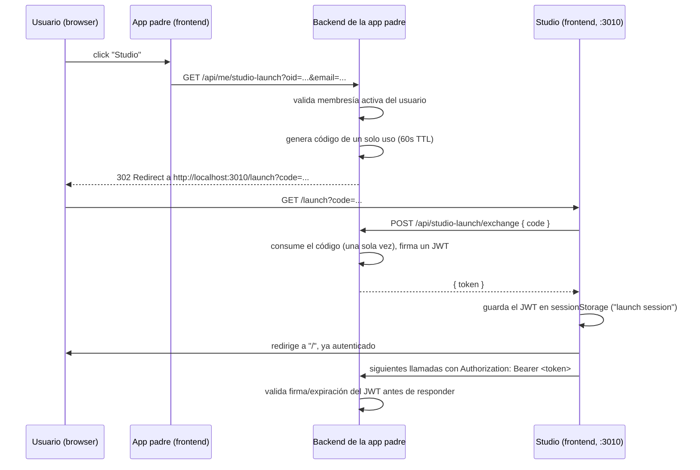

# Integrar el link de Studio desde otra app ("Studio launch")

Capability Studio (`http://localhost:3010` en dev) **ya no tiene login propio**.
Solo se abre lanzado desde una app "padre" que ya autenticó al usuario (MSAL,
o cualquier otro IdP). Este documento es la referencia para que **cualquier
app** agregue el botón "Studio" y Studio confíe en su identidad de forma
segura, sin volver a pedir login.

## Resumen del flujo



Ningún paso usa MSAL del lado de Studio. La única credencial que Studio
entiende es el JWT emitido por el backend de la app padre.

## 1. Backend de la app padre: dos endpoints

### a) `GET /api/me/studio-launch` — crea el código de lanzamiento

- Recibe la identidad del usuario ya autenticado en tu app (headers
  `X-Azure-OID`/`X-Azure-Email`, o query params `oid`/`email` si el frontend
  hace un `window.location.href =` directo).
- Valida que el usuario tenga una membresía/rol activo en tu dominio (tenant,
  organización, lo que aplique).
- Genera un código de un solo uso, de vida muy corta (30–60s), y lo guarda
  del lado del servidor asociado a los datos reales del usuario (tenantId,
  nombre, permisos, etc.). **No pongas esos datos en la URL** — solo el
  código.
- Responde con un `302 Found` cuyo `Location` sea
  `http://localhost:3010/launch?code=<code>` (usa el dominio real de Studio
  en producción).

Referencia de implementación real:
[CreateStudioLaunchFunction.cs](../../../NgoAutomateApp/backend/Functions/User/CreateStudioLaunchFunction.cs)

### b) `POST /api/studio-launch/exchange` — canjea el código por un JWT

- Recibe `{ "code": "..." }`.
- Consume el código (debe ser de un solo uso — bórralo del almacén al
  leerlo, para que no pueda reutilizarse ni compartirse).
- Si el código no existe o expiró, responde `401`.
- Si es válido, firma un JWT (HMAC-SHA256) con los claims descritos abajo y
  responde `{ "token": "<jwt>" }`.

Referencia de implementación real:
[ExchangeStudioLaunchFunction.cs](../../../NgoAutomateApp/backend/Functions/User/ExchangeStudioLaunchFunction.cs)
y el firmador/validador
[StudioSsoToken.cs](../../../NgoAutomateApp/backend/Services/StudioSsoToken.cs).

## 2. Contrato del JWT

- **Firma**: HMAC-SHA256 con un secreto compartido (`StudioLaunchJwtSecret`
  en `local.settings.json`/config de tu backend). El mismo secreto debe estar
  configurado en cualquier backend que necesite **validar** el token (hoy
  solo el backend de NGO firma y valida; si agregas otra app, decide si
  reutiliza ese mismo secreto o si Studio necesita aceptar tokens de varios
  emisores — ver sección "Múltiples apps padre" abajo).
- **Issuer**: `"ngo-automate-app"` (usa el nombre de tu app si implementas tu
  propio backend).
- **Audience**: `"capability-studio"`.
- **Expiración**: 12 horas (ajustable — es la duración de la sesión de
  trabajo dentro de Studio, no del código de un solo uso).
- **Claims** (todos como strings en el JWT, incluidos los booleanos):

| Claim              | Descripción                                                  |
|---------------------|---------------------------------------------------------------|
| `oid`               | Azure AD Object ID del usuario (o vacío si no aplica)         |
| `email`             | Correo del usuario                                             |
| `tenantId`          | GUID del tenant/organización en tu dominio                     |
| `tenantName`        | Nombre para mostrar de la organización                         |
| `memberId`          | GUID del registro de membresía (empleado/voluntario/etc.)      |
| `memberType`        | Tipo de miembro (`Employee`, `Volunteer`, ...) — solo display   |
| `sourceApplication` | Nombre corto de tu app (ej. `"ngo"`)                            |
| `studioView`        | `"True"`/`"False"` — puede abrir Studio                        |
| `studioCreate`      | Puede crear contenido                                          |
| `studioEdit`        | Puede editar contenido                                         |
| `studioDelete`      | Puede borrar contenido                                         |

## 3. Frontend de tu app: el botón "Studio"

No necesitas ninguna librería nueva. Es un simple `window.location.href` al
endpoint de creación de lanzamiento, pasando la identidad ya conocida por tu
app (del token/sesión que ya tienes):

```typescript
// Ejemplo real: NgoAutomateApp/app/src/components/NgoSidebar.tsx
async function openStudio() {
  window.location.href =
    `http://localhost:7072/api/me/studio-launch?oid=${encodeURIComponent(user.oid)}` +
    `&email=${encodeURIComponent(user.email)}`;
}
```

El backend hace el resto (crea el código, redirige a Studio, Studio canjea
el código). Tu frontend no necesita saber nada sobre JWTs.

## 4. Cómo Studio usa el token después

- `LaunchPage.tsx` (ruta `/launch`) hace el POST de canje y guarda el token
  en `sessionStorage` vía `auth/launchSession.ts`.
- Cada llamada de Studio a un backend (7071/7072 hoy) manda
  `Authorization: Bearer <token>` (ver `auth/index.ts` →
  `getIdentityHeaders()`).
- El backend que reciba esa llamada **debe validar la firma y expiración**
  del JWT antes de confiar en los claims — nunca aceptar los claims del JWT
  sin verificar la firma primero (evita que un usuario modifique su propio
  `sessionStorage` para escalar tenantId/permisos).
- `StudioSsoToken.Validate(...)` en el backend de NGO es el validador de
  referencia; cualquier backend nuevo que reciba el token debe reimplementar
  la misma verificación (mismo secreto, mismo issuer/audience).

## 5. Múltiples apps padre

Si otra app además de NGO quiere lanzar Studio:

- Opción simple (recomendada para empezar): que su backend llame al mismo
  par de endpoints del backend de NGO (`/me/studio-launch` +
  `/studio-launch/exchange`), reutilizando la misma base de usuarios/tenant.
- Opción propia: implementa tu propio par create-launch/exchange en tu
  backend, firmando con tu propio secreto. En ese caso, cualquier backend
  que Studio consulte (7071/7072 hoy) necesita saber validar tokens de
  **ambos** emisores (o Studio debe pasar también `?exchangeUrl=` para que
  `LaunchPage.tsx` sepa a qué backend canjear el código — ya soportado, ver
  `capabilitystudio/src/pages/LaunchPage.tsx`).

## 6. Seguridad — puntos clave

- El código de lanzamiento (`?code=`) es de un solo uso y expira en
  segundos; nunca pongas datos sensibles directamente en la URL de
  redirección.
- El JWT sí puede viajar en la URL de vuelta del canje solo porque va en el
  **body** de un POST, no en la query string.
- Studio decodifica el JWT del lado del cliente solo para mostrar datos en
  la UI (nombre de tenant, etc.) — **no** valida la firma en el browser (no
  se puede sin exponer el secreto). La validación real ocurre siempre en el
  backend en cada llamada.
- Si el usuario manipula el `sessionStorage` de Studio, solo afecta lo que
  ve en su propia sesión del navegador; cualquier dato que realmente importe
  (tenantId, permisos) se re-verifica en el backend vía la firma del JWT.
