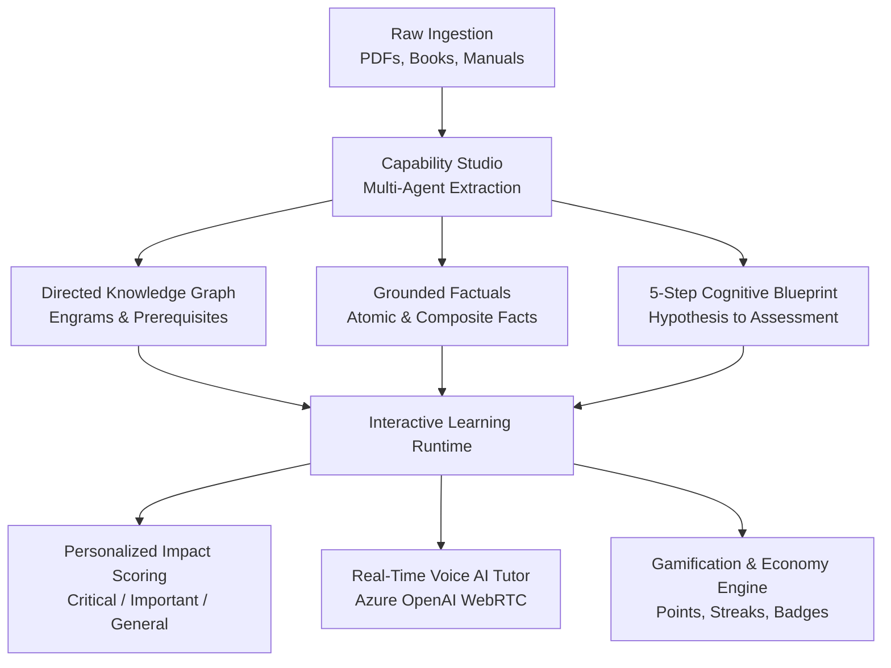
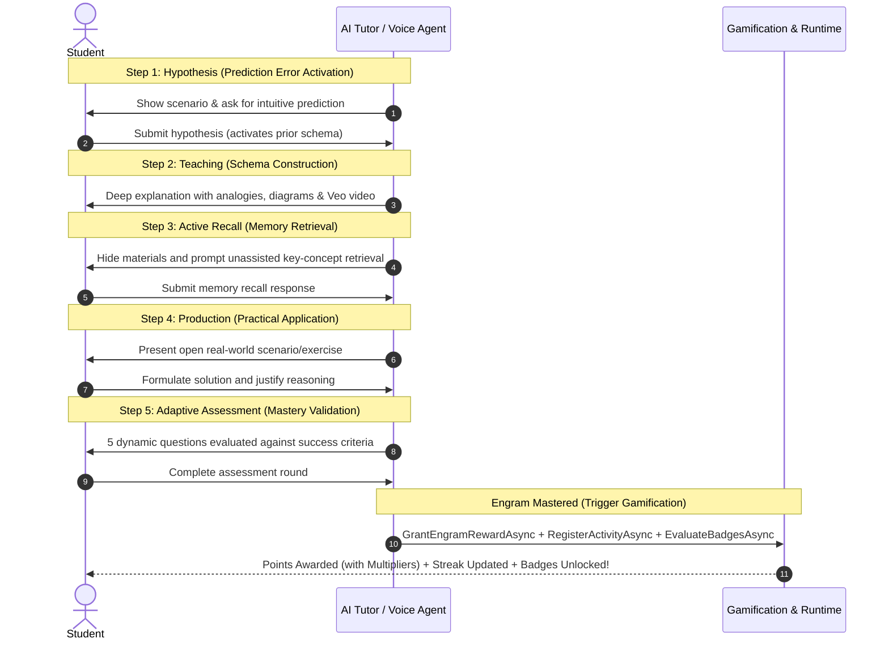
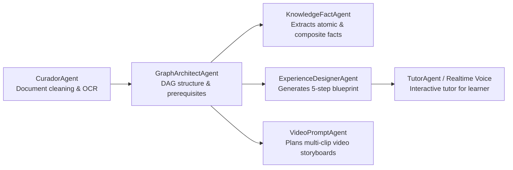
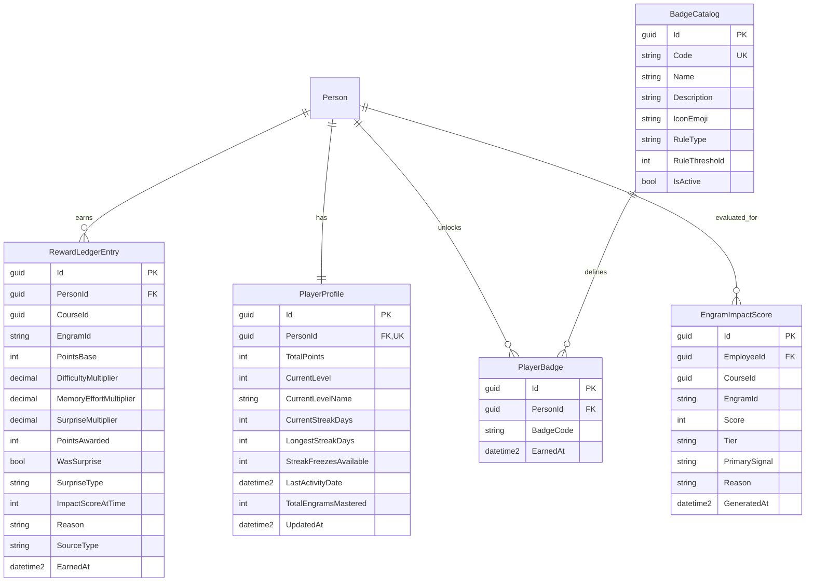

# Engrams: Complete System Architecture & Engineering Documentation

> **Ecosystem**: Human OS / Engram Academy  
> **Target Audience**: Core Engineers, Instructional Designers, AI Architects  
> **Philosophy**: *Humans First · AI Agents Second.*  
> *"The goal of AI is not cognitive offloading, but accelerating human capability, strengthening long-term memory, and turning complex knowledge into durable mental mastery."*

---

## Table of Contents
1. [Executive Summary & The Engram Vision](#1-executive-summary--the-engram-vision)
2. [Neuroscience Foundations & Anti-Offloading Learning](#2-neuroscience-foundations--anti-offloading-learning)
3. [The Atomic 5-Step Learning Blueprint](#3-the-atomic-5-step-learning-blueprint)
4. [Knowledge Graph & Master Entity Catalog](#4-knowledge-graph--master-entity-catalog)
5. [Factuals Engine (Knowledge Facts & Graph Paths)](#5-factuals-engine-knowledge-facts--graph-paths)
6. [Personalized Impact Scoring (`EngramImpactScore`)](#6-personalized-impact-scoring-engramimpactscore)
7. [Neuroscience-Based Gamification & Economy Engine](#7-neuroscience-based-gamification--economy-engine)
   - [7.1 Points & Multiplier Formula](#71-points--multiplier-formula)
   - [7.2 Variable Ratio & Dopaminergic Surprise System](#72-variable-ratio--dopaminergic-surprise-system)
   - [7.3 5-Tier Neuro-Leveling System](#73-5-tier-neuro-leveling-system)
   - [7.4 Daily Habit Streaks & Freeze Forgiveness](#74-daily-habit-streaks--freeze-forgiveness)
   - [7.5 Achievement Badge Catalog & Evaluation Engine](#75-achievement-badge-catalog--evaluation-engine)
8. [Multi-Agent Authoring Pipeline (Capability Studio)](#8-multi-agent-authoring-pipeline-capability-studio)
9. [Real-Time Voice Tutoring (WebRTC + Realtime API)](#9-real-time-voice-tutoring-webrtc--realtime-api)
10. [Multi-Clip Generative Video Pipeline (Google Veo)](#10-multi-clip-generative-video-pipeline-google-veo)
11. [Data Architecture & Azure SQL Schema](#11-data-architecture--azure-sql-schema)
12. [API Reference & Contracts](#12-api-reference--contracts)

---

## 1. Executive Summary & The Engram Vision

In traditional digital education, content is organized linearly into long video playlists and static multiple-choice questionnaires. When faced with difficulties, modern students often offload thinking to AI chatbots, which provides instant answers while degrading their own organic memory retention and reasoning ability (**The Memory Paradox**).

**Engrams** represent the atomic paradigm shift of the Human OS platform:
- **Atomic Mastery**: Knowledge is decomposed into independent, verifiable cognitive nodes called **Engrams**.
- **Active Schema Construction**: The student must form predictions, retrieve knowledge from unassisted memory, apply concepts in open scenarios, and pass dynamic AI assessments.
- **Personalized Relevance**: Every Engram is evaluated against the student's exact job role, departmental KPIs, and career aspirations via an AI scoring agent.
- **Dopamine-Grounded Motivation**: Points, variable ratio surprises, habit streaks with freeze forgiveness, and achievement badges reward effort and rescue fading memories.



---

## 2. Neuroscience Foundations & Anti-Offloading Learning

In neurobiology, an **engram** is the physical and biochemical trace that a memory leaves across synapses in the neural network. 

### 2.1 The Memory Paradox & Anti-Offloading
- **Passive Learning vs. Active Retrieval**: Reading or watching explanations creates the *illusion of competence*. Long-term retention only occurs when the brain is forced to retrieve information against friction (**Testing Effect**).
- **Desirable Difficulties**: Spaced intervals and active recall reconstruct neural pathways. Rescuing an engram that was nearly forgotten creates far stronger memory traces than reviewing already fresh concepts.
- **Prediction Errors**: Presenting a hypothesis challenge before explaining a concept primes the dopaminergic reward system when the correct mental schema is revealed.

---

## 3. The Atomic 5-Step Learning Blueprint

Every Engram node executes a deterministic, 5-phase cognitive contract:



---

## 4. Knowledge Graph & Master Entity Catalog

Rather than treating a course as a flat document, knowledge is mapped as a **Directed Acyclic Graph (DAG)**:

- **Graph Nodes (`CapabilityGraphNode`)**: Individual engrams containing academic definitions, practical interpretations, examples, and application constraints.
- **Graph Edges (`CapabilityGraphEdge`)**:
  - `Requires`: Strict topological dependency (Engram B cannot be studied before Engram A is mastered).
  - `BuildsOn`: Associative conceptual expansion.
- **Tenant Master Entity Catalog (`StructuredLearningEntity`)**: Canonical entities (e.g., *Ohm's Law*, *ISO 27001 Annex A.9*, *EBITDA Calculation*) are linked across multiple courses within the same organizational domain to track cross-course mastery.

---

## 5. Factuals Engine (Knowledge Facts & Graph Paths)

To prevent AI hallucination during interactive tutoring, knowledge is structured into verifiable units:

- **Atomic Facts (`KnowledgeFacts`)**: Single-hop relationships between two entities verified against source text citations.
- **Composite Facts & Paths (`KnowledgeFactGraphPathSteps`)**: Multi-hop deductive chains representing mechanisms and workflows.
- **Epistemic Classification**: Categorized by *Definition*, *Principle*, *Process/Function*, or *Outcome/Application*.

---

## 6. Personalized Impact Scoring (`EngramImpactScore`)

Not all engrams have the same value for every student. An autonomous background scoring agent evaluates every engram in a course against the student’s profile:

- **Inputs**: Job description, key departmental responsibilities, target skills, career roadmap goals, and manager coaching feedback.
- **Evaluation**: `EngramImpactScoringAgent` produces a score from 0 to 100 and assigns a tier:
  - **Critical (80–100)**: Direct impact on daily job execution or core KPIs.
  - **Important (50–79)**: Secondary competence or supporting domain skill.
  - **Optional / Foundational (0–49)**: General background knowledge.
- **Persistence**: Stored in `EngramImpactScore` with an upsert pattern on `(EmployeeId, CourseId, EngramId)`.

---

## 7. Neuroscience-Based Gamification & Economy Engine

The gamification architecture incorporates behavioral psychology and neurobiology to establish durable daily learning habits.

### 7.1 Points & Multiplier Formula
When a student masters an engram, total points are calculated and frozen in `RewardLedgerEntry`:

$$\text{PointsAwarded} = \text{round}\Big(\text{PointsBase} \times \text{DifficultyMultiplier} \times \text{MemoryEffortMultiplier} \times \text{SurpriseMultiplier}\Big)$$

1. **Base Points (`PointsBase`)**:
   - Equal to the personalized `EngramImpactScore` (0–100).
   - Defaults to **50** (neutral baseline) if no impact score has been generated yet.
2. **Difficulty Multiplier (`DifficultyMultiplier`)**:
   - Level 1: $1.0\times$
   - Level 2: $1.1\times$
   - Level 3: $1.2\times$
   - Level 4: $1.35\times$
   - Level 5: $1.5\times$
3. **Memory Effort Multiplier (`MemoryEffortMultiplier`)**:
   - Rewarding the retrieval of fading memories:
     - Memory Recall $\ge 80\%$: $1.0\times$ (fresh memory, standard effort)
     - Memory Recall $50\% - 79\%$: $1.3\times$ (moderate fading)
     - Memory Recall $25\% - 49\%$: $1.8\times$ (significant fading, heroic rescue)
     - Memory Recall $< 25\%$: $2.5\times$ (near-forgotten, maximum neuroplastic effort)
     - Fallback / Unlinked: $1.0\times$

### 7.2 Variable Ratio & Dopaminergic Surprise System
Based on Skinner's Variable Ratio Schedule of Reinforcement, random reward multipliers ignite dopamine:

| Roll (0–100) | Multiplier | Surprise Type | WasSurprise |
|---|---|---|---|
| **0 – 74** | $1.0\times$ | `NONE` | `false` |
| **75 – 92** | $1.5\times$ | `BONUS` | `true` |
| **93 – 98** | $2.0\times$ | `DOUBLE` | `true` |
| **99 – 100** | $3.0\times$ | `JACKPOT` | `true` |

### 7.3 5-Tier Neuro-Leveling System
Student progression is mapped to neurological complexity bands in `PlayerProfile`:

| Level | Level Name | Points Range | Threshold to Next |
|---|---|---|---|
| **Level 1** | **Neurona** | 0 – 499 pts | 500 pts |
| **Level 2** | **Sinapsis** | 500 – 1,499 pts | 1,500 pts |
| **Level 3** | **Circuito** | 1,500 – 3,499 pts | 3,500 pts |
| **Level 4** | **Red Neuronal** | 3,500 – 6,999 pts | 7,000 pts |
| **Level 5** | **Mente Maestra** | 7,000+ pts | Max Level Achieved |

### 7.4 Daily Habit Streaks & Freeze Forgiveness
`StreakService` evaluates daily learning activity comparing strictly by calendar date (`.Date` in UTC):
- **First Activity Ever**: `CurrentStreakDays = 1`, `StreakChanged = "STARTED"`.
- **Same Day Activity**: Streak unchanged, `StreakChanged = "ALREADY_COUNTED_TODAY"`.
- **Next Calendar Day**: `CurrentStreakDays += 1`, `StreakChanged = "CONTINUED"`.
- **2+ Days Inactivity Gap**:
  - If `StreakFreezesAvailable > 0`: Consumes 1 freeze, maintains streak, `StreakChanged = "FROZEN"`.
  - If `StreakFreezesAvailable == 0`: Resets streak to 1, `StreakChanged = "BROKEN"`.
- **Personal Best**: `LongestStreakDays` records the highest streak achieved.

### 7.5 Achievement Badge Catalog & Evaluation Engine
`BadgeService` performs idempotent evaluations against active catalog badges:

| Badge Code | Name | Icon | Rule Type | Threshold | Description |
|---|---|---|---|---|---|
| `first_neuron` | Primera Neurona | 🎯 | `engrams_mastered` | 1 | Mastered first engram |
| `memory_rescuer` | Rescatista Memoria | 🧠 | `memory_rescued` | 10 | Rescued 10 fading engrams (multiplier $\ge 1.8$) |
| `streak_7` | Racha de 7 Días | 🔥 | `streak_days` | 7 | Maintained 7-day learning streak |
| `automatic_pilot` | Piloto Automático | ⚡ | `automatic_engrams` | 5 | 5 engrams consolidated to automaticity *(My Brain)* |
| `critical_guardian` | Guardián Critical | 🛡️ | `critical_mastered` | 10 | Mastered 10 Critical tier engrams |
| `lucky_jackpot` | Afortunado | 🎲 | `jackpot_hit` | 1 | Hit a 3.0x Jackpot surprise bonus |
| `complete_brain` | Cerebro Completo | 🏆 | `course_completed` | 1 | 100% course engrams completed |

---

## 8. Multi-Agent Authoring Pipeline (Capability Studio)

Capability Studio uses Microsoft Agent Framework with Azure OpenAI:



---

## 9. Real-Time Voice Tutoring (WebRTC + Realtime API)

Interactive voice-based retrieval is delivered with sub-second latency:
- **Engine**: Azure OpenAI GPT Realtime API (`gpt-realtime-mini` / `gpt-4o-realtime-preview`).
- **WebRTC Ephemeral Tokens**: The server generates short-lived client secrets (`POST /openai/v1/realtime/client_secrets`) with pre-injected step instructions. The browser establishes direct audio streaming without exposing the master API key.
- **`EngramReviewCompletion`**: Successful conversational reviews count toward automaticity retention signals on the student's Brain dashboard.

---

## 10. Multi-Clip Generative Video Pipeline (Google Veo)

For complex spatial and operational concepts, Capability Studio produces sequential educational videos:
- **Storyboard Decomposition**: Generates 1 to 4 sequential 10-second prompt segments.
- **Frame Continuity Engine**: Extracts the exact final frame of Clip $N$ using ffmpeg (`-sseof -0.5 -frames:v 1`) and uses it as the starting visual reference for Clip $N+1$, preventing visual jumping across clips.

---

## 11. Data Architecture & Azure SQL Schema

### Gamification & Engram Tables Overview



### Database Indexes & Constraints
1. `RewardLedgerEntry`: Unique Index `(PersonId, CourseId, EngramId)` guarantees strict idempotency (points can never be earned twice for the same engram).
2. `PlayerProfile`: Unique Index `(PersonId)` enforces single-profile integrity.
3. `BadgeCatalog`: Unique Index `(Code)`.
4. `PlayerBadge`: Unique Index `(PersonId, BadgeCode)` prevents duplicate badge awards.
5. `EngramImpactScore`: Unique Index `(EmployeeId, CourseId, EngramId)`.

---

## 12. API Reference & Contracts

### Gamification Endpoints (`GamificationFunction`)

#### 1. Player Profile Summary
- **Endpoint**: `GET /api/gamification/profile`
- **Authentication**: Azure AD (`X-Azure-OID` / `X-Azure-TID`) or `X-Person-Id`
- **Response (`200 OK`)**:
```json
{
  "totalPoints": 1850,
  "currentLevel": 3,
  "currentLevelName": "Circuito",
  "currentStreakDays": 7,
  "longestStreakDays": 12,
  "streakFreezesAvailable": 1,
  "totalEngramsMastered": 14,
  "pointsToNextLevel": 1650,
  "nextLevelName": "Red Neuronal"
}
```

#### 2. Active Badge Collection
- **Endpoint**: `GET /api/gamification/badges`
- **Response (`200 OK`)**:
```json
[
  {
    "code": "first_neuron",
    "name": "Primera Neurona",
    "description": "¡Has dominado tu primer engrama! El viaje del conocimiento ha comenzado.",
    "iconEmoji": "🎯",
    "isEarned": true,
    "earnedAt": "2026-09-01T20:15:00Z",
    "ruleType": "engrams_mastered",
    "ruleThreshold": 1
  },
  {
    "code": "streak_7",
    "name": "Racha de 7 Días",
    "description": "Mantuviste tu hábito de aprendizaje durante 7 días consecutivos.",
    "iconEmoji": "🔥",
    "isEarned": true,
    "earnedAt": "2026-09-01T22:00:00Z",
    "ruleType": "streak_days",
    "ruleThreshold": 7
  },
  {
    "code": "critical_guardian",
    "name": "Guardián Critical",
    "description": "Dominaste 10 engramas de impacto crítico para tu rol.",
    "iconEmoji": "🛡️",
    "isEarned": false,
    "earnedAt": null,
    "ruleType": "critical_mastered",
    "ruleThreshold": 10
  }
]
```

#### 3. Recent Reward History Ledger
- **Endpoint**: `GET /api/gamification/rewards/recent?limit=20`
- **Response (`200 OK`)**:
```json
[
  {
    "engramId": "engram-pid-control-tuning",
    "pointsAwarded": 389,
    "wasSurprise": true,
    "surpriseType": "DOUBLE",
    "reason": "Mastered engram-pid-control-tuning (impact 80) — DOUBLE bonus",
    "earnedAt": "2026-09-01T22:30:00Z"
  }
]
```

---

## 13. Verification & Test Suite Summary

The system is validated by comprehensive automated test suites covering all edge cases:
- **`RewardEngineServiceTests`**: Deterministic calculations, memory rescue multipliers, surprise bands, level-up boundaries, and strict idempotency.
- **`StreakServiceTests`**: UTC calendar `.Date` comparisons, freeze forgiveness consumption, broken streaks, and historic records.
- **`BadgeServiceTests`**: Idempotent catalog seeding, rule triggers (`engrams_mastered`, `streak_days`, `critical_mastered`, `jackpot_hit`), and safe fallback on unlinked metrics.
- **`GamificationFunctionTests`**: Read-only DTO mapping and next-level progression calculation across all 5 bands.
- **All 43 unit tests passing in test runner**.
