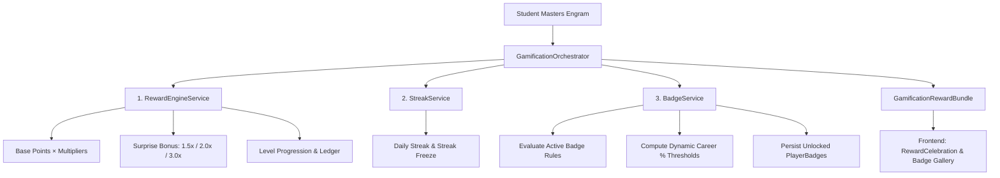
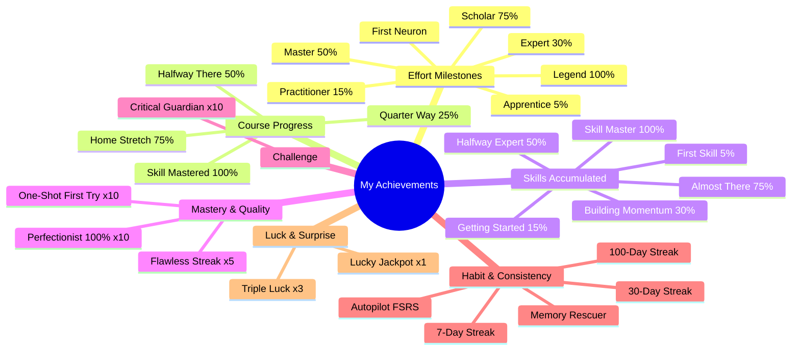

# 🏆 Human OS — My Achievements (Mis Logros) Solution Architecture

This document provides a comprehensive, one-by-one technical and neuro-science breakdown of the **"My Achievements" (Mis Logros)** system in Human OS.

---

## 1. System Overview & Neuroscience Foundation

The **Achievements & Gamification Engine** in Human OS is not just a cosmetic badge system—it is built on **cognitive neuroscience principles** designed to drive long-term habit formation, active memory recall, and dopamine-reinforced motivation:

### Key Pillars:
1. **Dynamic Career Scaling**: Milestone thresholds adapt dynamically to each employee's specific assigned Career Plan and enrolled courses (e.g., 5%, 15%, 30%, 50%, 75%, 100%).
2. **Variable Ratio Schedule of Reinforcement (B.F. Skinner / Dopamine)**: Random surprise bonuses (Jackpot 3.0x, Double 2.0x, Bonus 1.5x) keep engagement high without predictability fatigue.
3. **Spaced Repetition & Memory Science (FSRS)**: Badges reward rescuing fading memories (<50% retrievability) and achieving automatic memory consolidation.
4. **Strict Idempotency & Zero Duplicate Grants**: Every achievement is locked to an exact rule condition and granted once per user in database transactions.

---

## 2. Complete Breakdown of Achievements (One by One)

The system features **24 distinct badges** organized across **7 functional categories**:

---

### Category A: Effort Milestones (`Effort` / Esfuerzo)
*Measures total cumulative knowledge nodes (engrams) mastered across all learning formats.*

| Badge Code | Name & Icon | Description & Threshold Rule | Neuroscience & Educational Objective |
| :--- | :--- | :--- | :--- |
| `first_neuron` | 🎯 **First Neuron** *(Primera Neurona)* | **1 Engram Mastered** `ruleType: engrams_mastered` | Immediate positive feedback on the very first learning victory. |
| `effort_10` | 🌱 **Apprentice** *(Aprendiz)* | **5% of Available Engrams** `ruleType: engrams_mastered` (min 1) | Rewards foundational neural wiring as the employee begins their journey. |
| `effort_25` | 📘 **Practitioner** *(Practicante)* | **15% of Available Engrams** `ruleType: engrams_mastered` (min 1) | Reinforces early study habit as momentum starts building. |
| `effort_50` | 🎓 **Expert** *(Experto)* | **30% of Available Engrams** `ruleType: engrams_mastered` (min 1) | Recognizes consistent effort turning into substantial practical capability. |
| `effort_100` | 🏅 **Master** *(Maestro)* | **50% of Available Engrams** `ruleType: engrams_mastered` (min 1) | Halfway through the full career roadmap; deep cognitive expansion. |
| `effort_200` | 💎 **Scholar** *(Erudito)* | **75% of Available Engrams** `ruleType: engrams_mastered` (min 1) | Demonstrates rare, high-level dedication to comprehensive mastery. |
| `effort_300` | 👑 **Legend** *(Leyenda)* | **100% of Available Engrams** `ruleType: engrams_mastered` (min 1) | Pinnacle achievement: every single engram in their career scope mastered. |

---

### Category B: Course Progress (`Progress` / Progreso)
*Measures completion percentage within any single course.*

| Badge Code | Name & Icon | Description & Threshold Rule | Neuroscience & Educational Objective |
| :--- | :--- | :--- | :--- |
| `skill_progress_25` | 🥉 **Quarter Way** *(Primer Cuarto)* | **25% Course Completion** `ruleType: course_progress_pct` (Threshold: 25) | Early milestone preventing abandonment during initial difficulty curve. |
| `skill_progress_50` | 🥈 **Halfway There** *(A Medio Camino)* | **50% Course Completion** `ruleType: course_progress_pct` (Threshold: 50) | Psychological midpoint boost where the finish line becomes attainable. |
| `skill_progress_75` | 🥇 **Home Stretch** *(Recta Final)* | **75% Course Completion** `ruleType: course_progress_pct` (Threshold: 75) | Creates urgency and excitement to finish the final remaining concepts. |
| `skill_complete_1` | 🛡️ **Skill Mastered** *(Habilidad Dominada)* | **100% Course Completion** `ruleType: course_completed` (Threshold: 1) | Full mastery of a course's entire cognitive structure. |

---

### Category C: Skills Accumulated (`Skills` / Habilidades)
*Measures multi-course breadth and completion across the employee's entire Career Plan.*

| Badge Code | Name & Icon | Description & Threshold Rule | Neuroscience & Educational Objective |
| :--- | :--- | :--- | :--- |
| `skills_1` | 🏆 **First Skill** *(Primera Habilidad)* | **5% of Career Courses** `ruleType: skills_completed` (min 1) | Celebrates finishing the first complete multi-lesson capability. |
| `skills_3` | 🌱 **Getting Started** *(Comenzando)* | **15% of Career Courses** `ruleType: skills_completed` (min 1) | Early breadth validation across multiple functional skills. |
| `skills_6` | 🚀 **Building Momentum** *(Tomando Impulso)* | **30% of Career Courses** `ruleType: skills_completed` (min 1) | Cross-domain versatility and self-driven progression. |
| `skills_10` | 🥈 **Halfway Expert** *(Experto Intermedio)* | **50% of Career Courses** `ruleType: skills_completed` (min 1) | Broad organizational competency across job-role, soft-skills & company processes. |
| `skills_15` | 🥇 **Almost There** *(Casi Listo)* | **75% of Career Courses** `ruleType: skills_completed` (min 1) | Senior-level competence covering nearly all assigned skills. |
| `skills_all` | 🥷 **Skill Master** *(Dominio Total)* | **100% of Career Courses** `ruleType: all_skills_completed` (min 1) | Total career plan completion—every required role and company skill mastered. |

---

### Category D: Mastery & Quality (`Quality` / Calidad)
*Rewards precision, depth of comprehension, and assessment accuracy.*

| Badge Code | Name & Icon | Description & Threshold Rule | Neuroscience & Educational Objective |
| :--- | :--- | :--- | :--- |
| `quality_perfect_10` | 🎯 **Perfectionist** *(Perfeccionista)* | **10 Perfect 100% Scores** `ruleType: perfect_scores` (Threshold: 10) | Encourages meticulous study rather than rushing through quizzes. |
| `quality_firsttry_10` | 🧠 **One-Shot** *(A la Primera)* | **10 First-Try Masteries** `ruleType: first_try_masteries` (Threshold: 10) | Rewards deep attention during the initial teaching/deep-dive steps. |
| `quality_flawless_5` | 🔥 **Flawless** *(Impecable)* | **5 Consecutive High-Score First-Try Masteries** `ruleType: flawless_streak` (Threshold: 5) | Flow-state recognition for uninterrupted, high-accuracy learning streaks. |

---

### Category E: Challenge (`Challenge` / Desafío)
*Rewards overcoming high-impact, critical business concepts.*

| Badge Code | Name & Icon | Description & Threshold Rule | Neuroscience & Educational Objective |
| :--- | :--- | :--- | :--- |
| `critical_guardian` | 🛡️ **Critical Guardian** *(Guardián Crítico)* | **10 Critical Tier Engrams Mastered** `ruleType: critical_mastered` (Threshold: 10) | Focuses attention on mission-critical skills with highest role impact score. |

---

### Category F: Habit & Consistency (`Habit` / Hábitos)
*Leverages Spaced Repetition (FSRS) and continuous daily learning rituals.*

| Badge Code | Name & Icon | Description & Threshold Rule | Neuroscience & Educational Objective |
| :--- | :--- | :--- | :--- |
| `streak_7` | 🔥 **7-Day Streak** *(Racha de 7 Días)* | **7 Active Days in a Row** `ruleType: streak_days` (Threshold: 7) | Forms initial habit loop (Cue → Routine → Reward). |
| `streak_30` | 🌟 **30-Day Streak** *(Racha de 30 Días)* | **30 Active Days in a Row** `ruleType: streak_days` (Threshold: 30) | Consolidates continuous learning into an established daily ritual. |
| `streak_100` | 💫 **100-Day Streak** *(Racha de 100 Días)* | **100 Active Days in a Row** `ruleType: streak_days` (Threshold: 100) | Master-level discipline and cultural learning leadership. |
| `automatic_pilot` | ⚡ **Autopilot** *(Piloto Automático)* | **5 Engrams in Permanent Memory** `ruleType: automatic_engrams` (Threshold: 5) | FSRS memory state reaches 100% automatic retention via spaced review. |
| `memory_rescuer` | 🧠 **Memory Rescuer** *(Rescatista de Memoria)* | **10 Fading Memories Rescued** `ruleType: memory_rescued` (Threshold: 10) | Active recall intervention when memory retrievability drops below 50%. |

---

### Category G: Luck & Surprise (`Luck` / Suerte)
*Leverages variable-ratio reinforcement to maintain high excitement and delight.*

| Badge Code | Name & Icon | Description & Threshold Rule | Neuroscience & Educational Objective |
| :--- | :--- | :--- | :--- |
| `lucky_jackpot` | 🎲 **Lucky** *(Afortunado)* | **1 Jackpot Hit (3.0x Multiplier)** `ruleType: jackpot_hit` (Threshold: 1) | Celebrates the thrilling occurrence of a maximum dopamine bonus. |
| `lucky_triple` | 🎰 **Triple Luck** *(Triple Suerte)* | **3 Jackpot Multipliers Hit** `ruleType: jackpot_hit` (Threshold: 3) | Rewards long-term dedication with repeat high-value surprise rewards. |

---

## 3. Architecture & Data Flow

### Database Entities
- **`BadgeCatalog`**: Defines badge code, category, name, description, emoji icon, rule type, threshold, and active status.
- **`PlayerBadge`**: Immutable grant record linking `PersonId`, `BadgeCode`, and `EarnedAt`.
- **`PlayerProfile`**: Stores player aggregate level, current XP, total engrams mastered, streak days, streak freeze status, and last activity date.
- **`RewardLedgerEntry`**: Audit log of every point transaction with multiplier breakdowns (Base, Difficulty, Memory Effort, Surprise Bonus).

### Backend Pipeline
1. When an engram is mastered in `CompleteNodeFunction` (Knowledge Graph) or `PostStructuredLearningSubmitFunction` (Structured Learning), it calls:
   `GamificationOrchestrator.ProcessEngramMasteryAsync(...)`
2. `RewardEngineService` computes points and surprise multipliers, writing an immutable ledger record.
3. `StreakService` updates streak count and resets/maintains streak freezes.
4. `BadgeService.EvaluateAndGrantBadgesAsync` evaluates all unearned candidate badges, dynamically calculating thresholds against the student's career roadmap, saves newly earned badges, and returns them to the caller.
5. `BadgeService.GetBadgeProgressAsync` powers the read-only gallery UI, returning current progress %, target values, and ordering earned items first followed by closest-to-unlock items.

### Frontend UI Components
- **`GamificationProfilePanel`** (Header): Displays level, neuron rank, total points, streak counter, and opens the achievements modal.
- **`BadgeGalleryModal` / `BadgeGallery`**: Categorized view with progress bars, "Close to Unlocking" spotlight, category filters, and earned status.
- **`RewardCelebration`**: Confetti animation and full multiplier breakdown dialog whenever a lesson completes or a new badge is unlocked.

---

## 4. Key Innovation: Dynamic Roadmap-Relative Calibration

Unlike traditional static learning badges (e.g. "Complete 100 courses" which might be impossible if an employee is only assigned 8 courses), Human OS uses **Dynamic Career Scaling**:

$$\text{Effective Target} = \max\left(1, \left\lceil \text{Total Assigned in Career Plan} \times \text{Milestone Percentage} \right\rceil\right)$$

- **Apprentice**: $5\%$ of total career engrams
- **Practitioner**: $15\%$
- **Expert**: $30\%$
- **Master**: $50\%$
- **Scholar**: $75\%$
- **Legend**: $100\%$ of all assigned engrams

This ensures every single employee experiences a tailored, rewarding, and completely achievable progression curve regardless of their department or role length.
