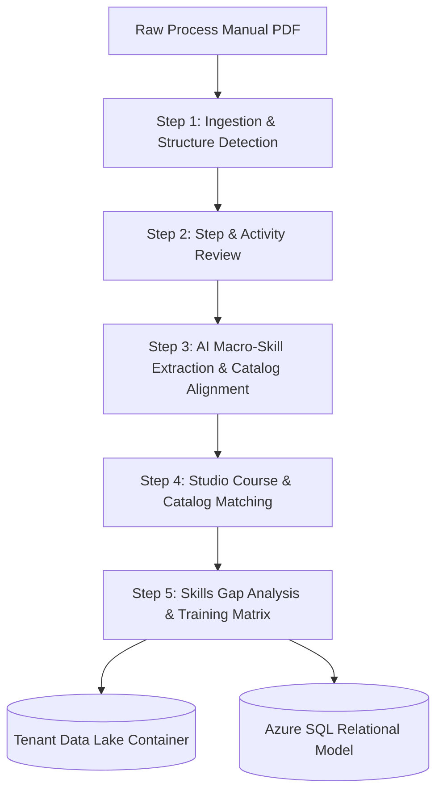
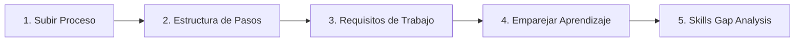
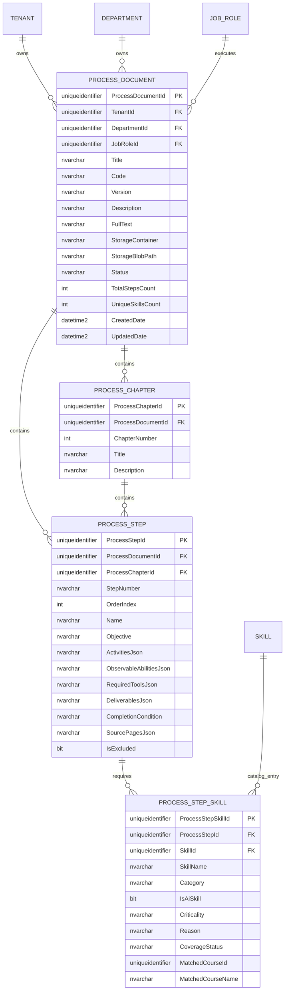

# Human OS — Process-to-Learning & Skills Gap Analysis Architecture

> **Document Version**: 1.0  
> **Status**: Approved & Implemented  
> **Target Audience**: Architects, Software Engineers, Instructional Designers, HR Executives  

---

## 1. Executive Summary

Operational manuals, Standard Operating Procedures (SOPs), and business workflow documents often sit unread in company repositories. When organizations attempt to train employees on these manuals, they usually face two major failure modes:
1. **Superficial Overview**: Assigning a 150-page PDF without determining the actual competencies required to execute each specific work step.
2. **Micro-Fragmentation**: Breaking down every single activity or task into an isolated training item, resulting in unmanageable, fragmented checklists (e.g., 40 micro-courses for 40 sub-tasks).

The **Human OS Process-to-Learning & Skills Gap Analysis** system transforms raw operational PDFs into a **Macro-Skills Training Matrix** connected directly to the organization's skill catalog and active courses in **Capability Studio**.



---

## 2. Core Architectural Principles

### 2.1 The 1 Skill = 1 Full Course Principle
In Human OS, a **Skill** is defined at the **macro-competency level**, meaning:
- **1 Skill = 1 Full Training Course / Curriculum Module** in Capability Studio (e.g., *Prompt Engineering*, *Stakeholder Management*, *Process Mapping & Modeling (BPMN)*, *Business Discovery & Analysis*).
- An atomic task or individual action (e.g., *"Schedule meeting on calendar"*, *"Open engagement template"*, *"Take meeting notes"*) is **never** a skill.

### 2.2 Strict Separation: Skills vs. Tools
Software programs, platforms, and templates are classified strictly as **Tools**, never as Skills:
- **Tools**: Microsoft Teams, Outlook / Email, Google Calendar, Excel, Slack, Jira, Confluence, Master Document Templates.
- **Skills**: Facilitation & Interviewing, Data Privacy & Security for Project Work, Stakeholder Management.
- Tools are stored in `RequiredTools` and highlighted as supporting instruments, preventing catalog pollution.

### 2.3 The 4 Canonical Categories + Mandatory AI Skill
Every work step must evaluate and map required competencies into standard corporate categories:

| Category Key | Column Name | Description & Examples |
| :--- | :--- | :--- |
| `soft-skills` | **Habilidades Blandas (Soft Skills)** | Interpersonal, negotiation, stakeholder management, facilitation, leadership. |
| `job-skills` | **Habilidades Técnicas / Puesto** | Role-specific technical, analytical, or engineering skills (e.g., BPMN modeling, architecture validation). |
| `department-processes` | **Procesos (Dept / RRHH)** | Departmental workflows, operational protocols, compliance, and governance. |
| `hr-processes` | **Procesos (Dept / RRHH)** | Corporate HR policies, code of conduct, and organizational compliance. |
| `aiSkills` (`isAiSkill: true`) | **Habilidades de IA (Mandatorio)** | **Mandatory in Human OS**. Every work step must evaluate how AI accelerates the step (e.g., *AI-Assisted Business Analysis*, *Prompt Engineering*). |

### 2.4 Catalog Reuse & Synonym Deduplication
To prevent synonymous skill proliferation (e.g., Step 1 proposing *"Managing Stakeholders"*, Step 2 proposing *"Stakeholder Engagement"*, Step 3 proposing *"Client Relations"*):
1. **Catalog Injection**: The organization's existing catalog (`dbo.Skill`) is loaded and fed directly to the AI agent prompt.
2. **Cumulative Registry**: When running batch analysis, skills identified in Step $N$ are accumulated into a runtime registry and passed to Step $N+1$, instructing the model to reuse exact names and canonical identifiers (`skill-soft-stakeholder-management`).

---

## 3. The 5-Step Process-to-Learning Wizard

The enterprise workflow is presented in a streamlined 5-step wizard in `human-os-enterprise`:



### Step 1: Subir Proceso (Upload & Ingestion)
- The user uploads an SOP, operational guide, procedure document, or corporate policy (PDF).
- The document is uploaded to the tenant's dedicated Blob Storage container (`{tenantId}/process-documents/{documentId}/source/`).
- **Two-Tier Extraction Engine (`ProcessDocumentExtractionService`)**:
  1. *Tier 1 (Page-by-Page Layout Extraction)*: Reads text, tables, and paragraphs page by page using `PdfPig`. Evaluates explicit step patterns.
  2. *Tier 2 (AI Process Structure Extractor)*: If the document is an unstructured policy, a narrative manual, or an SOP without explicit "Paso" markers (fewer than 2 steps detected by regex), an AI agent (`ProcessDocumentExtractionAgent` powered by `gpt-5-mini`) analyzes the page-by-page text, extracting the true document title, grouping into logical chapters/phases, and identifying all work steps, policy rules, required activities, recommended tools, and deliverables.

### Step 2: Estructura de Pasos (Review & Curate)
- The user reviews the extracted hierarchy: Chapters, Work Steps, Sub-steps, Activities, Deliverables, and Completion Conditions.
- Steps can be excluded or re-ordered before initiating AI analysis.

### Step 3: Requisitos de Trabajo (Batch Macro-Skill Extraction)
- Replaces one-by-one manual analysis with a unified action: **`🚀 Analyze All Steps in Batch (Recommended)`**.
- `WorkStepRequirementsAnalyzer` runs across each step using Azure OpenAI (`gpt-5-mini`), matching capabilities against `dbo.Skill` and previous steps.
- Outputs human observable abilities (`EmployeeMustBeAbleTo`), required tools (`RequiredTools`), and categorized macro-skills.

### Step 4: Emparejar Aprendizaje (Catalog & Studio Match)
- Executed via batch: **`🚀 Match All Steps in Batch`**.
- `EngramStudioCatalogService` queries `dbo.StructuredLearningDocument`, `dbo.Capability`, and tenant catalog entries to find ready-to-teach courses matching the required skills.

### Step 5: Skills Gap Analysis & Matriz de Capacitación
- Renders the **Process Training & Skill Matrix (4 Columns)**:
  1. *Habilidades Blandas (Soft)*
  2. *Habilidades Técnicas / Puesto*
  3. *Procesos (Dept / RRHH)*
  4. *Habilidades de IA (Mandatorio)*
- Each skill displays its availability status:
  - 🟢 **Listo en Studio**: The skill is in the catalog and has an active course published in Studio.
  - 🟡 **Curso Pendiente**: The skill is registered in the catalog, but its training course is not yet authored in Studio.
  - 🔴 **No en Catálogo**: The skill was newly discovered by the process and does not exist in the company catalog.
- **1-Click Bulk Catalog Registration**: An action banner allows adding all $N$ missing skills to `dbo.Skill` in a single click (`createSkill`), instantly promoting them to *Curso Pendiente*.
- **Finalizar Skills Gap Analysis ✓**: Persists the complete manual text, steps, and matrix to Azure SQL and Data Lake Storage.

---

## 4. Multi-Tenant Storage Architecture (Azure Data Lake)

In Human OS, **the tenant owns their dedicated Blob container**. Storage is isolated per company using the tenant's GUID:

### 4.1 Container Naming Convention
```
Container Name: {tenantId} (lowercase GUID, e.g., 81c35f10-60ab-4ca4-b2ec-6c4bee8d0c0b)
```

### 4.2 File Hierarchy
```
{tenantId}/
└── process-documents/
    └── {documentId}/
        ├── source/
        │   └── original.pdf                       <- Original uploaded file
        ├── extracted/
        │   └── document-intelligence-result.json  <- Raw extracted text, pages & paragraphs
        └── structured/
            └── process-structure.json             <- Approved JSON structure (chapters & steps)
```

---

## 5. Relational Database Model (Azure SQL)

The persistence model captures the complete hierarchy and the Training Matrix in 4 dedicated tables under the `dbo` schema:



### Table Specifications:

1. **`dbo.ProcessDocument`**:
   - `FullText`: Consolidated text of the manual for full-text search, regex, and embeddings.
   - `StorageContainer`: Name of the tenant's Blob container.
   - `StorageBlobPath`: Relative path to `process-structure.json`.
   - `TotalStepsCount` & `UniqueSkillsCount`: Fast KPI indexing without aggregations.

2. **`dbo.ProcessChapter`**:
   - Maintains the ordered phase structure of the process.

3. **`dbo.ProcessStep`**:
   - Contains the exact work step details, activities, and success conditions.

4. **`dbo.ProcessStepSkill`**:
   - Represents the **Process Training Matrix**.
   - Directly links steps with `dbo.Skill` and course references in `dbo.StructuredLearningDocument` / `dbo.Capability`.

---

## 6. Backend API Endpoints

| Method | Route | Description |
| :--- | :--- | :--- |
| `POST` | `/api/process-documents` | Uploads PDF, stores in tenant container, and extracts initial structure. |
| `GET` | `/api/process-documents/{id}` | Retrieves the structured process manual from storage. |
| `POST` | `/api/process-documents/{id}/steps/{stepId}/analyze-requirements` | Runs AI macro-skill extraction for a step, reusing catalog skills. |
| `POST` | `/api/process-documents/{id}/steps/{stepId}/content-coverage` | Evaluates coverage against `dbo.Skill` and published Studio courses. |
| `POST` | `/api/process-documents/{id}/save-analysis` | **Persists process, chapters, steps, and the full training matrix to Azure SQL.** |

### 6.1 Save Analysis Request Contract (`POST .../save-analysis`)
```json
{
  "title": "Business Discovery Process",
  "code": "SOP-DISC-001",
  "description": "Standard discovery protocol for enterprise projects",
  "departmentId": "4a123f89-...",
  "jobRoleId": "81c35f10-...",
  "stepRequirements": {
    "step-1": { ... },
    "step-2": { ... }
  },
  "stepCoverages": {
    "step-1": { ... },
    "step-2": { ... }
  }
}
```

---

## 7. Verification & Telemetry Checklist

- [x] Storage container resolves dynamically to lowercase `{tenantId}`.
- [x] Fallback mechanisms gracefully support legacy storage layouts without breaking existing uploads.
- [x] EF Core migration `20260910203210_AddProcessDocumentTables` executed on Azure SQL (`HumanOSDev`).
- [x] Frontend builds with zero TypeScript errors across React 19 / Vite.
- [x] Reactive bilingual localization (Spanish / English) without hardcoded strings.
